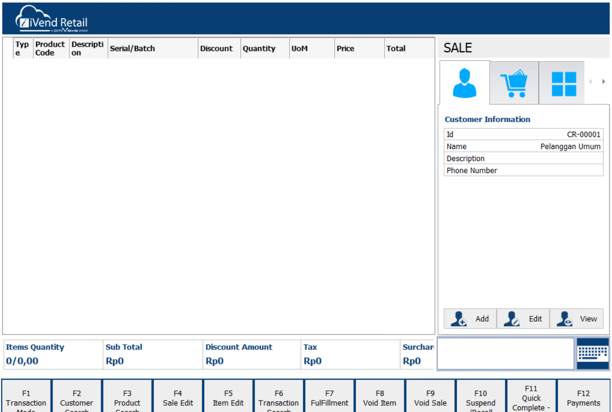
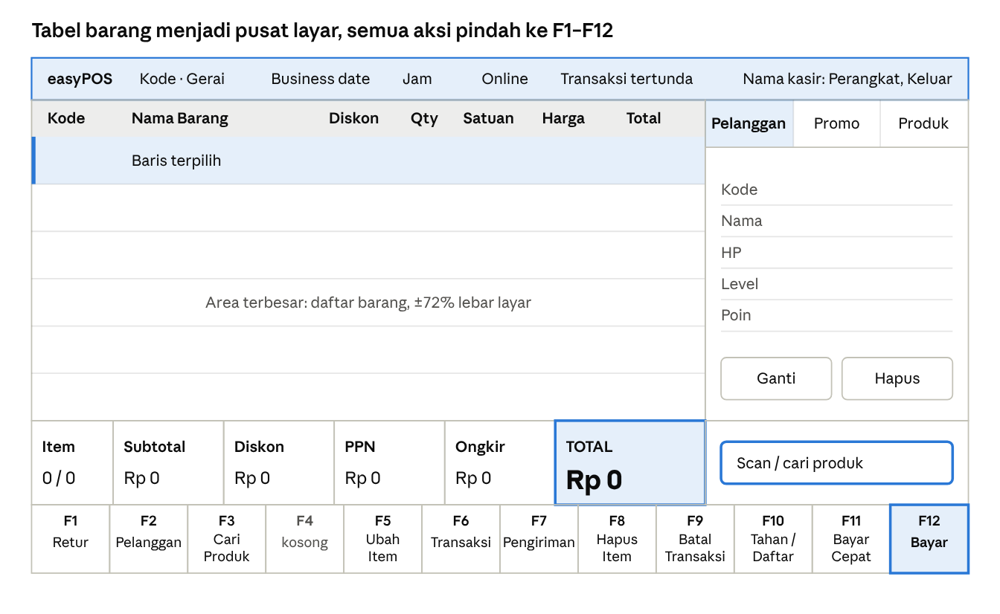

# Design Brief — Layar POS easyPOS

| | |
|---|---|
| Tanggal | 5 November 2026 |
| Melengkapi | `docs/Design-Brief-easyPOS-SaaS-MVP.md` |

## Ringkasan

Layar POS diubah dari katalog berbasis kartu menjadi layar transaksi berbasis tabel dan keyboard, mengikuti pola layout iVend Retail. Keranjang menjadi area utama, katalog pindah ke panel kanan, dan semua aksi kasir pindah ke 12 tombol fungsi F1–F12 di tepi bawah.

Yang berubah hanya tampilan dan cara kasir mengoperasikannya. Aturan penjualan, promosi, pajak, stok, offline, dan EOD tetap sama. Identitas tetap easyPOS: logo, warna, dan nama iVend tidak dipakai.

## Referensi

Yang diambil dari iVend Retail adalah susunan dan pola kerjanya, bukan tampilannya. Di bawah ini perinciannya per elemen.

| Elemen di referensi | Keputusan | Catatan untuk easyPOS |
| --- | --- | --- |
| Tabel barang sebagai area terbesar (±71% lebar) | Ambil | Menggantikan grid kartu produk |
| Panel kanan bertab (pelanggan, keranjang, grid) | Ambil | Isi tab disesuaikan fitur easyPOS |
| Baris ringkasan angka di bawah tabel | Ambil, ditambah | Referensi terpotong setelah Surcharge; TOTAL wajib terlihat dan paling besar |
| Kotak input di kanan bawah | Ambil | Menjadi kotak scan dan pencarian |
| 12 tombol fungsi di tepi bawah | Ambil | Label diindonesiakan, urutan F-key sama |
| Header biru tua | Ambil polanya | Warna dari token easyPOS, logo easyPOS |
| Teks terpotong (“Typ e”, “Descripti on”, “Surchar”, label F1) | Tidak | Label harus utuh di resolusi minimum |
| Istilah Inggris, ikon, dan logo iVend | Tidak | Bahasa Indonesia, Material Symbols, logo easyPOS |

## Kondisi saat ini

Layar sekarang mengutamakan mouse: katalog kartu mengisi area utama, keranjang sempit (420 px) di kanan, dan belum ada satu pun shortcut keyboard. Ini belum memenuhi prinsip P1 di `docs/Design-Brief-easyPOS-SaaS-MVP.md`, yaitu alur scan, bayar, cetak tanpa mouse.

Fitur berikut sudah ada dan wajib tetap ada setelah redesign:

- Scan barcode dan pencarian nama/SKU, dengan fokus otomatis
- Kartu produk dengan gambar, harga, dan stok; produk stok habis nonaktif
- Baris keranjang dengan qty, promosi per baris, dan saran bonus promosi
- Pelanggan default retail, ganti, hapus, dan daftar baru
- Pembayaran multi metode, status lunas/pending, kembalian, dan pengiriman
- Tahan dan lanjutkan transaksi, retur per nomor struk, serta cetak struk
- Status online/offline, jumlah transaksi tertunda, tanggal bisnis, jam, dan peringatan EOD
- Sapaan login, konfirmasi EOD tertunda, dan pemberitahuan pindah gerai
- Pengaturan printer USB dan tombol keluar

## Struktur layout

Layar dibagi menjadi enam zona tetap yang tidak ikut scroll; hanya isi tabel dan panel kanan yang bisa di-scroll.

Ukuran di bawah ini adalah usulan untuk lebar 1366 px.

| Zona | Ukuran | Isi |
| --- | --- | --- |
| Header | Tinggi 48 px | Logo, gerai, business date, jam, status online, transaksi tertunda, menu kasir |
| Pita peringatan | Tinggi 32 px, hanya bila ada | Peringatan EOD |
| Tabel barang | Sisa tinggi, lebar ±986 px | Baris keranjang dan saran bonus |
| Panel kanan | Lebar 380 px | Tab Pelanggan, Promo & Bonus, Produk |
| Ringkasan | Tinggi 72 px | Item (baris/qty), Subtotal, Diskon, PPN, Ongkir, TOTAL |
| Kotak input | Sejajar ringkasan, lebar 380 px | Scan barcode dan cari produk, selalu fokus |
| Tombol fungsi | Tinggi 64 px, selebar layar | F1–F12 |

**Catatan angka:** Subtotal di easyPOS sudah dikurangi diskon, sedangkan di referensi Subtotal dan Discount tampil berdampingan. Beri label “Subtotal setelah diskon” agar diskon tidak terbaca terpotong dua kali. Sel Ongkir selalu tampil, walau Rp 0, agar posisi angka tidak bergeser.

## Pemetaan fitur

Delapan dari 12 tombol sudah punya fitur di easyPOS, sehingga cukup dipindahkan. F4 dibiarkan nonaktif, sedangkan F6, F9, dan F11 perlu dibuat. Urutan mengikuti referensi dan menggantikan shortcut di brief lama (F2 Bayar, F4 Tahan, F6 Retur), yang belum pernah diimplementasikan.

| Tombol | Label easyPOS | Fungsi | Di referensi | Kondisi fitur |
| --- | --- | --- | --- | --- |
| F1 | Retur | Retur per nomor struk | Transaction Mode | Sudah ada |
| F2 | Pelanggan | Cari, pilih, atau daftarkan pelanggan | Customer Search | Sudah ada |
| F3 | Cari Produk | Buka tab Produk dan fokus ke kotak input | Product Search | Sudah ada |
| F4 | (kosong) | Nonaktif; belum ada padanan di easyPOS | Sale Edit | Tidak dibuat |
| F5 | Ubah Item | Ubah qty baris terpilih | Item Edit | Qty sudah ada, dialog baru |
| F6 | Transaksi | Daftar transaksi gerai pada business date aktif dan cetak ulang struk | Transaction Search | Belum dibuat, sesuai rencana daftar transaksi POS |
| F7 | Pengiriman | Data penerima dan biaya kirim | FulFillment | Sudah ada, pindah dari dialog bayar |
| F8 | Hapus Item | Hapus baris terpilih setelah konfirmasi | Void Item | Sudah ada, konfirmasi baru |
| F9 | Batal Transaksi | Kosongkan keranjang setelah konfirmasi | Void Sale | Baru |
| F10 | Tahan / Daftar | Keranjang berisi: tahan. Keranjang kosong: buka daftar tahan | Suspend/Recall | Sudah ada, digabung |
| F11 | Bayar Cepat | Selesaikan transaksi tunai sebesar total | Quick Complete (label terpotong) | Baru |
| F12 | Bayar | Buka dialog pembayaran | Payments | Sudah ada |

F9 berbeda dari void. Void transaksi yang sudah tersimpan tetap khusus Store Manager/Owner dengan alasan (FR-A8-10), dan aksesnya masuk ke daftar F6. Bila keranjang berasal dari transaksi tahan, F9 mengembalikannya ke daftar tahan, sesuai perilaku saat ini.

**Kolom tabel:** Kode, Nama Barang, Diskon, Qty, Satuan, Harga, Total. Nama promosi tampil kecil di bawah nama barang.

- Kolom Type dibuang karena keranjang selalu berisi penjualan; retur punya alur sendiri.
- Kolom Serial/Batch dibuang karena skema database easyPOS tidak menyimpan data itu.
- Kolom Satuan perlu tambahan kecil: `unit` sudah dikirim API produk, tetapi belum disimpan di baris keranjang.

**Tab panel kanan:**

- **Pelanggan** (bawaan): kode, nama, HP, level, dan poin, dengan tombol Ganti dan Hapus.
- **Promo & Bonus**: promosi yang sedang berlaku di keranjang dan tombol tambah bonus, dengan badge jumlah bonus tersedia.
- **Produk**: kartu produk dua kolom dengan gambar, harga, dan stok, terfilter oleh kotak input.

**Perangkat** dan **Keluar** tidak punya tempat di referensi, jadi masuk ke menu nama kasir di header.

## Arahan visual

Gunakan token yang sudah ada di `public/css/tokens.css`, tanpa warna baru. Palet Elegant Blue sudah dekat dengan referensi. Token `--pos-*` bernuansa teal di brief lama tidak lagi sesuai dengan tokens.css dan tidak dipakai.

| Elemen | Warna | Tipografi | Bentuk |
| --- | --- | --- | --- |
| Header | `--color-primary-hover` (#173E70), teks putih | Inter 14/600 | Tanpa radius, tanpa bayangan |
| Kepala tabel | `--color-surface-2` | Inter 13/600 | Garis bawah `--color-outline-strong` |
| Baris tabel | `--color-surface` | Nama Inter 14; angka dan kode IBM Plex Mono 14 | Tinggi 40 px, garis 1 px |
| Baris terpilih | `--color-primary-container` | Sama dengan baris biasa | Garis kiri 3 px `--color-primary` |
| Label ringkasan | `--color-primary` | Inter 12/600 | Sel dipisah garis 1 px |
| Angka ringkasan | `--color-text` | IBM Plex Mono 18/600 | Rata kiri |
| TOTAL | `--color-primary`, teks putih | IBM Plex Mono 32/700 | Sel paling lebar |
| Tombol fungsi | `--color-surface-2`, garis `--color-outline` | Nama tombol Plex Mono 12/600; aksi Inter 13 | Radius `--radius-xs` |
| F12 Bayar | `--color-primary`, teks putih | Sama dengan tombol fungsi | Satu-satunya tombol terisi |
| Peringatan | `--color-accent-container` | Inter 13/600 | Pita selebar layar |

Merah hanya untuk error dan konfirmasi hapus; F8 dan F9 tetap netral sampai dialog konfirmasi muncul. Nominal memakai format `Rp 12.000` tanpa desimal, sesuai formatter saat ini.

## Interaksi dan status

Fokus selalu kembali ke kotak input setelah setiap aksi, agar kasir bisa langsung memindai barang berikutnya.

| Tombol | Aksi |
| --- | --- |
| Enter di kotak input | Kode cocok: tambah ke keranjang. Tidak cocok: buka tab Produk dengan hasil pencarian |
| Panah atas/bawah | Pindah baris terpilih |
| + dan − | Ubah qty baris terpilih saat kotak input kosong |
| Delete | Sama dengan F8, membuka konfirmasi |
| Esc | Tutup dialog atau kosongkan kotak input |

- Tidak ada aksi hapus satu tombol tanpa konfirmasi, sesuai aturan brief lama.
- Saat dialog terbuka, tombol F tidak aktif dan dialog tidak boleh bertumpuk.
- Semua tombol fungsi juga bisa diklik atau disentuh.

**Bentrok dengan browser:** F1, F3, F5, F6, F7, F10, F11, dan F12 punya fungsi bawaan di Chromium. Semuanya harus dicegat dan diuji di browser target. F5 paling berisiko karena keranjang belum disimpan, sehingga muat ulang tak sengaja menghapus isinya.

| Kondisi | Tampilan |
| --- | --- |
| Offline | Chip Offline di header dan jumlah transaksi tertunda |
| EOD tertunda | Pita amber dan tanggal posting di header |
| EOD sudah ditutup | Pita peringatan bahwa transaksi online terkunci |
| Keranjang kosong | Pesan di tabel; F5, F8, F9, F11, dan F12 nonaktif |
| Tahan tersimpan | Badge jumlah pada F10 |
| Stok habis | Kartu produk nonaktif dengan label Stok habis |
| Notifikasi | Snackbar di atas baris ringkasan, tidak menutupi TOTAL |
| Sapaan, konfirmasi EOD, pindah gerai | Dialog wajib seperti sekarang; semua tombol F nonaktif |

**Responsif:** ponsel di bawah 768 px tetap tidak didukung.

| Lebar layar | Panel kanan | Tombol fungsi |
| --- | --- | --- |
| 1280 px ke atas | 380 px, selalu terlihat | 1 baris isi 12 |
| 1024–1279 px | 320 px, selalu terlihat | 1 baris isi 12, label dua baris |
| 768–1023 px | Laci geser, dibuka dari tombol | 2 baris isi 6, tinggi minimal 48 px |

## Batasan dan kriteria selesai

Perhitungan promosi, pajak, stok, antrean offline, tahan, dan EOD tidak berubah. Perubahan terutama ada di `resources/js/pos/App.jsx` dan `public/css/pos.css`. Setelah disetujui, wireframe POS dan daftar shortcut di brief lama perlu diperbarui.

- [ ] Alur scan, bayar, dan cetak selesai tanpa mouse
- [ ] TOTAL selalu terlihat tanpa scroll
- [ ] Tidak ada label terpotong pada lebar 1280 px
- [ ] Semua fitur di bagian Kondisi saat ini masih bisa dicapai
- [ ] Tombol F tidak memicu fungsi bawaan Chromium
- [ ] Tampilan offline, EOD tertunda, dan EOD ditutup sudah diperiksa
- [ ] Tes POS yang ada tetap lulus

## Keputusan

Semua keputusan berikut disetujui pada 5 November 2026.

| Pertanyaan | Keputusan |
| --- | --- |
| F4 diisi apa? | Biarkan kosong dan nonaktif, agar nomor tombol lain tetap sama dengan referensi |
| F11 Bayar Cepat memakai metode apa? | Tunai sebesar total. Metode pertama di daftar belum tentu tunai, jadi metode harus ditentukan jelas |
| Apakah F5 mencakup diskon baris manual? | Tahap ini qty saja. FR-A8-03 menyebut diskon baris, tetapi layar saat ini hanya punya diskon promosi |
| Apakah ikon keyboard virtual di referensi diikuti? | Tidak, tablet sudah punya keyboard layar sendiri |
| Status bar bawah dipindah ke header? | Ya, agar tombol F berada di tepi bawah seperti referensi. Istilah “status bar” di FR-A8-17 perlu disesuaikan |
| Bagaimana tampilan tablet? | Laci geser menggantikan bottom sheet di brief lama, agar tabel tetap menjadi area utama |
