# Entity Relationship Diagram (ERD) - easyPOS

Dokumen ini menggambarkan struktur database aplikasi **easyPOS** berdasarkan migration files yang sudah ada di `database/migrations`. Semua primary key menggunakan **UUID v7** (kecuali tabel framework Laravel seperti `jobs`, `cache`, `personal_access_tokens`).

---

## Daftar Isi

1. [Konvensi & Catatan Umum](#1-konvensi--catatan-umum)
2. [Diagram ERD Keseluruhan](#2-diagram-erd-keseluruhan)
3. [Diagram per Modul](#3-diagram-per-modul)
   - 3.1 [Master Data & Konfigurasi](#31-master-data--konfigurasi)
   - 3.2 [Produk, Harga & Promosi](#32-produk-harga--promosi)
   - 3.3 [Pelanggan & Loyalty](#33-pelanggan--loyalty)
   - 3.4 [Penjualan](#34-penjualan)
   - 3.5 [Stok](#35-stok)
   - 3.6 [POS, Sesi & Tutup Kasir](#36-pos-sesi--tutup-kasir)
4. [Detail Entitas](#4-detail-entitas)
5 [Tabel Relasi (Foreign Keys)](#5-tabel-relasi-foreign-keys)

---

## 1. Konvensi & Catatan Umum

| Aspek | Konvensi |
|-------|----------|
| **Primary Key** | `id` UUID (v7) untuk hampir semua tabel domain. |
| **Tenant/Company Scope** | Hampir semua tabel memiliki `company_id` FK ke `company_details`. |
| **Timestamps** | `created_at` & `updated_at` Laravel standar, kecuali tabel log/ledger yang hanya `created_at`. |
| **Soft Delete** | Tidak digunakan; data dihapus secara fisik atau di-mark (`status`, `is_active`). |
| **Currency** | `decimal(15,2)` untuk nilai uang; `decimal(15,3)` untuk quantity. |
| **FK Cascade** | Umumnya `cascadeOnDelete` untuk data perusahaan; `nullOnDelete` untuk referensi user/customer. |

---

## 2. Diagram ERD Keseluruhan

```mermaid
erDiagram
    COMPANY_DETAILS ||--o{ STORES : "mempunyai"
    COMPANY_DETAILS ||--o{ USERS : "mempunyai"
    COMPANY_DETAILS ||--o{ UNITS : "mempunyai"
    COMPANY_DETAILS ||--o{ PRODUCT_GROUPS : "mempunyai"
    COMPANY_DETAILS ||--o{ BRANDS : "mempunyai"
    COMPANY_DETAILS ||--o{ PRODUCTS : "mempunyai"
    COMPANY_DETAILS ||--o{ PRICE_LISTS : "mempunyai"
    COMPANY_DETAILS ||--o{ PROMOTIONS : "mempunyai"
    COMPANY_DETAILS ||--o{ PAYMENT_TYPES : "mempunyai"
    COMPANY_DETAILS ||--o{ CREDIT_CARDS : "mempunyai"
    COMPANY_DETAILS ||--o{ CURRENCIES : "mempunyai"
    COMPANY_DETAILS ||--o{ CUSTOMERS : "mempunyai"
    COMPANY_DETAILS ||--o{ CUSTOMER_GROUPS : "mempunyai"
    COMPANY_DETAILS ||--o{ MEMBER_LEVELS : "mempunyai"
    COMPANY_DETAILS ||--o{ SALES : "mempunyai"
    COMPANY_DETAILS ||--o{ SALES_RETURNS : "mempunyai"
    COMPANY_DETAILS ||--o{ STOCK_ADJUSTMENTS : "mempunyai"
    COMPANY_DETAILS ||--o{ STOCK_TRANSFERS : "mempunyai"
    COMPANY_DETAILS ||--o{ STOCK_LEDGER : "mempunyai"
    COMPANY_DETAILS ||--o{ STORE_CLOSURES : "mempunyai"
    COMPANY_DETAILS ||--o{ WAREHOUSES : "mempunyai"
    COMPANY_DETAILS ||--o{ WAREHOUSE_STOCKS : "mempunyai"
    COMPANY_DETAILS ||--o{ WAREHOUSE_STOCK_LEDGERS : "mempunyai"
    COMPANY_DETAILS ||--o{ TAX_GROUPS : "mempunyai"
    COMPANY_DETAILS ||--o{ NUMBERING_CONFIGS : "mempunyai"
    COMPANY_DETAILS ||--o{ ACTIVITY_LOGS : "mempunyai"
    COMPANY_DETAILS ||--o{ POS_ACTIVE_CARTS : "mempunyai"
    COMPANY_DETAILS ||--o{ POS_SESSIONS : "mempunyai"
    COMPANY_DETAILS ||--o{ POS_CANCELLATIONS : "mempunyai"
    COMPANY_DETAILS ||--o{ SAP_SYNC_RUNS : "mempunyai"
    COMPANY_DETAILS ||--o{ LOYALTY_CONFIG : "mempunyai"
    COMPANY_DETAILS ||--|| TAX_GROUPS : "default_tax_group"

    STORES ||--o{ USERS : "mempunyai"
    STORES ||--o{ SALES : "terjadi di"
    STORES ||--o{ SALE_DRAFTS : "terjadi di"
    STORES ||--o{ STOCK_LEDGER : "pergerakan"
    STORES ||--o{ STOCK_ADJUSTMENTS : "di"
    STORES ||--o{ STOCK_TRANSFERS_FROM : "from"
    STORES ||--o{ STOCK_TRANSFERS_TO : "to"
    STORES ||--o{ STORE_CLOSURES : "ditutup"
    STORES ||--o{ POS_ACTIVE_CARTS : "aktif di"
    STORES ||--o{ POS_SESSIONS : "berlangsung di"
    STORES ||--o{ POS_CANCELLATIONS : "di"
    STORES ||--o{ WAREHOUSES : "1-1"
    STORES ||--o{ PRICE_LISTS : "bisa punya"
    STORES ||--o{ PAYMENT_TYPES : "terdaftar"

    USERS ||--o{ SALES : "sebagai cashier"
    USERS ||--o{ SALES : "sebagai resolver"
    USERS ||--o{ SALE_DRAFTS : "membuat"
    USERS ||--o{ STOCK_LEDGER : "membuat"
    USERS ||--o{ STOCK_ADJUSTMENTS : "membuat"
    USERS ||--o{ STOCK_TRANSFERS : "membuat"
    USERS ||--o{ STORE_CLOSURES : "menutup"
    USERS ||--o{ STORE_CLOSURES : "membuka ulang"
    USERS ||--o{ LOYALTY_LEDGER : "membuat"
    USERS ||--o{ WAREHOUSE_STOCK_LEDGERS : "membuat"
    USERS ||--o{ POS_SESSIONS : "membuka"
    USERS ||--o{ POS_ACTIVE_CARTS : "milik"
    USERS ||--o{ POS_CANCELLATIONS : "membatalkan"
    USERS ||--o{ ACTIVITY_LOGS : "actor"

    PRODUCT_GROUPS ||--o{ PRODUCTS : "mengelompokkan"
    BRANDS ||--o{ PRODUCTS : "brand"
    UNITS ||--o{ PRODUCTS : "satuan"
    PRODUCTS ||--o{ SALE_LINES : "terjual"
    PRODUCTS ||--o{ SALES_RETURN_LINES : "dikembalikan"
    PRODUCTS ||--o{ PRICE_LIST_ITEMS : "dipricing"
    PRODUCTS ||--o{ STOCK_LEDGER : "bergerak"
    PRODUCTS ||--o{ STOCK_ADJUSTMENT_LINES : "disesuaikan"
    PRODUCTS ||--o{ STOCK_TRANSFER_LINES : "ditransfer"
    PRODUCTS ||--o{ WAREHOUSE_STOCKS : "tersedia di"
    PRODUCTS ||--o{ WAREHOUSE_STOCK_LEDGERS : "bergerak"
    PRODUCTS ||--o{ PROMOTIONS : "promo"
    PRODUCTS ||--o{ PROMOTIONS : "get_product"

    PRICE_LISTS ||--o{ PRICE_LIST_ITEMS : "memuat"
    PRICE_LISTS ||--o{ STORES : "default purchase"

    CUSTOMER_GROUPS ||--o{ CUSTOMERS : "mengelompokkan"
    MEMBER_LEVELS ||--o{ CUSTOMERS : "level"
    CUSTOMERS ||--o{ SALES : "pembeli"
    CUSTOMERS ||--o{ LOYALTY_LEDGER : "point"
    CUSTOMERS ||--o{ POS_CANCELLATIONS : "dibatalkan"

    SALES ||--o{ SALE_LINES : "memuat"
    SALES ||--o{ SALE_PAYMENTS : "dibayar"
    SALES ||--o{ DELIVERIES : "dikirim"
    SALES ||--o{ SALES_RETURNS : "dasar return"
    SALES ||--o{ POS_CANCELLATIONS : "void"

    SALE_LINES ||--o{ SALES_RETURN_LINES : "dikembalikan"
    SALE_LINES ||--o{ PROMOTIONS : "menggunakan"

    PAYMENT_TYPES ||--o{ SALE_PAYMENTS : "cara bayar"
    PAYMENT_TYPES ||--o{ CREDIT_CARDS : "mapping"

    CURRENCIES ||--o{ CURRENCY_DENOMINATIONS : "pecahan"

    STOCK_ADJUSTMENTS ||--o{ STOCK_ADJUSTMENT_LINES : "detail"
    STOCK_TRANSFERS ||--o{ STOCK_TRANSFER_LINES : "detail"

    STORE_CLOSURES ||--o{ STORE_CLOSURE_DENOMINATIONS : "pecahan"

    WAREHOUSES ||--o{ WAREHOUSE_STOCKS : "saldo"
    WAREHOUSES ||--o{ WAREHOUSE_STOCK_LEDGERS : "pergerakan"

    POS_SESSIONS ||--o{ POS_CANCELLATIONS : "terkait"
```



---

## 3. Diagram per Modul

### 3.1 Master Data & Konfigurasi

```mermaid
erDiagram
    COMPANY_DETAILS {
        uuid id PK
        string name
        text address
        string logo_path
        string npwp_number
        string phone
        string email
        boolean ppn_enabled
        decimal ppn_rate
        boolean ppn_inclusive
        uuid tax_group_id FK
        string base_currency_code
        string timezone
        boolean allow_negative_stock
        integer return_window_days
        boolean return_require_receipt
        json sku_config
        text payment_providers
        boolean sap_enabled
        string sap_endpoint_url
        string sap_db_name
        string sap_username
        text sap_password
        json promotion_hierarchy
        timestamps
    }

    COMPANY_DETAILS ||--|| TAX_GROUPS : "default"
    COMPANY_DETAILS ||--o{ STORES : "mempunyai"
    COMPANY_DETAILS ||--o{ USERS : "mempunyai"
    COMPANY_DETAILS ||--o{ NUMBERING_CONFIGS : "punya"
    COMPANY_DETAILS ||--o{ ACTIVITY_LOGS : "punya"
    COMPANY_DETAILS ||--o{ SAP_SYNC_RUNS : "punya"
    COMPANY_DETAILS ||--|| LOYALTY_CONFIG : "punya"

    TAX_GROUPS {
        uuid id PK
        uuid company_id FK
        string code
        string name
        decimal rate
        date effective_from
        string source
        boolean is_active
        timestamps
    }

    STORES {
        uuid id PK
        uuid company_id FK
        string code
        string name
        text address
        string pic_name
        string pic_phone
        boolean ppn_enabled
        decimal ppn_rate
        string currency
        uuid purchase_price_list_id FK
        uuid warehouse_id FK
        uuid default_customer_id FK
        boolean is_active
        timestamps
    }

    USERS {
        uuid id PK
        uuid company_id FK
        uuid store_id FK
        string name
        string username UK
        string email UK
        string phone
        enum role
        boolean is_active
        string password
        timestamps
    }

    NUMBERING_CONFIGS {
        uuid id PK
        uuid company_id FK
        string transaction_type
        string prefix
        integer padding
        string separator
        enum reset_period
        string last_period
        bigint last_number
        timestamps
    }

    ACTIVITY_LOGS {
        uuid id PK
        uuid company_id FK
        uuid actor_id FK
        string actor_name
        string action
        string subject_type
        uuid subject_id
        text description
        json properties
        timestamp created_at
    }

    SAP_SYNC_RUNS {
        uuid id PK
        uuid company_id FK
        string mode
        string trigger
        string status
        json summary
        text error
        timestamp started_at
        timestamp finished_at
        timestamps
    }
```

### 3.2 Produk, Harga & Promosi

```mermaid
erDiagram
    UNITS {
        uuid id PK
        uuid company_id FK
        string code
        string name
        boolean is_active
        timestamps
    }

    PRODUCT_GROUPS {
        uuid id PK
        uuid company_id FK
        string code
        string name
        text description
        boolean is_active
        timestamps
    }

    BRANDS {
        uuid id PK
        uuid company_id FK
        string code
        string name
        boolean is_active
        timestamps
    }

    PRODUCTS {
        uuid id PK
        uuid company_id FK
        uuid product_group_id FK
        uuid brand_id FK
        uuid unit_id FK
        string sku
        string barcode
        string name
        string image_path
        text description
        decimal base_price
        decimal cost_price
        boolean track_stock
        boolean is_active
        timestamps
    }

    PRICE_LISTS {
        uuid id PK
        uuid company_id FK
        uuid store_id FK
        string code
        string name
        boolean is_default
        date effective_from
        date effective_until
        boolean is_active
        timestamps
    }

    STORE_PRICE_LISTS {
        uuid store_id PK,FK
        uuid price_list_id PK,FK
        boolean is_default
        timestamps
    }

    PRICE_LIST_ITEMS {
        uuid id PK
        uuid price_list_id FK
        uuid product_id FK
        decimal price
        integer min_qty
        timestamps
    }

    PROMOTIONS {
        uuid id PK
        uuid company_id FK
        string code
        string name
        string type
        decimal value
        uuid product_id FK
        uuid get_product_id FK
        uuid brand_id FK
        uuid product_group_id FK
        integer min_qty
        integer buy_qty
        integer get_qty
        integer max_applications
        timestamp starts_at
        timestamp ends_at
        boolean is_active
        text description
        timestamps
    }

    PRODUCTS }o--|| PRODUCT_GROUPS : "group"
    PRODUCTS }o--|| BRANDS : "brand"
    PRODUCTS }o--|| UNITS : "unit"
    PRODUCTS ||--o{ PRICE_LIST_ITEMS : "termuat"
    PRICE_LISTS ||--o{ PRICE_LIST_ITEMS : "memuat"
    PRICE_LISTS }o--o{ STORES : "store_price_lists"
    PRODUCTS }o--|| PROMOTIONS : "promo"
    PRODUCTS }o--|| PROMOTIONS : "get_product"
    BRANDS }o--|| PROMOTIONS : "brand"
    PRODUCT_GROUPS }o--|| PROMOTIONS : "group"
```

### 3.3 Pelanggan & Loyalty

```mermaid
erDiagram
    CUSTOMER_GROUPS {
        uuid id PK
        uuid company_id FK
        string code
        string name
        string source
        boolean is_default
        boolean is_active
        timestamps
    }

    MEMBER_LEVELS {
        uuid id PK
        uuid company_id FK
        string name
        decimal min_points
        decimal earn_amount_per_point
        integer order
        boolean is_active
        timestamps
    }

    CUSTOMERS {
        uuid id PK
        uuid company_id FK
        string code
        string name
        string phone
        string email
        text address
        boolean is_member
        uuid member_level_id FK
        uuid customer_group_id FK
        decimal points_balance
        timestamp joined_at
        boolean is_active
        timestamps
    }

    LOYALTY_CONFIG {
        uuid id PK
        uuid company_id FK
        decimal min_spend
        enum rounding
        integer expiry_days
        boolean is_active
        timestamps
    }

    LOYALTY_LEDGER {
        uuid id PK
        uuid company_id FK
        uuid customer_id FK
        enum type
        decimal points
        decimal balance_after
        string ref_type
        uuid ref_id
        text note
        uuid created_by FK
        timestamp created_at
    }

    CUSTOMER_GROUPS ||--o{ CUSTOMERS : "group"
    MEMBER_LEVELS ||--o{ CUSTOMERS : "level"
    CUSTOMERS ||--o{ LOYALTY_LEDGER : "point history"
```

### 3.4 Penjualan

```mermaid
erDiagram
    SALES {
        uuid id PK
        uuid company_id FK
        uuid store_id FK
        string number
        uuid client_uuid UK
        enum origin
        enum sync_status
        date business_date
        enum type
        uuid customer_id FK
        decimal points_earned
        uuid cashier_id FK
        enum status
        enum stock_review_status
        text review_reason
        uuid resolved_by FK
        timestamp resolved_at
        decimal subtotal
        decimal discount_total
        decimal tax_total
        decimal shipping_cost
        decimal total
        decimal paid_total
        decimal change_total
        string currency_code
        timestamp sold_at
        timestamp voided_at
        text void_reason
        string sap_post_status
        text sap_post_error
        integer sap_invoice_obj_type
        string sap_invoice_doc_num
        integer sap_invoice_doc_entry
        integer sap_payment_obj_type
        string sap_payment_doc_num
        integer sap_payment_doc_entry
        timestamp sap_posted_at
        timestamps
    }

    SALE_LINES {
        uuid id PK
        uuid sale_id FK
        uuid product_id FK
        string sku_snapshot
        string name_snapshot
        decimal unit_price
        decimal qty
        decimal discount
        uuid promotion_id FK
        string promotion_name_snapshot
        decimal promotion_discount
        decimal tax_amount
        decimal line_total
        string tax_group_code
        decimal tax_rate
        timestamps
    }

    SALE_PAYMENTS {
        uuid id PK
        uuid sale_id FK
        uuid payment_type_id FK
        decimal amount
        enum status
        string provider
        string provider_ref
        string approval_code
        timestamp confirmed_at
        timestamps
    }

    DELIVERIES {
        uuid id PK
        uuid sale_id FK
        string recipient_name
        string phone
        text address
        decimal shipping_cost
        enum status
        text note
        timestamp shipped_at
        timestamp delivered_at
        timestamps
    }

    SALES_RETURNS {
        uuid id PK
        uuid company_id FK
        uuid store_id FK
        string number
        uuid original_sale_id FK
        text reason
        decimal total
        string refund_method
        boolean receipt_verified
        uuid created_by FK
        timestamps
    }

    SALES_RETURN_LINES {
        uuid id PK
        uuid sales_return_id FK
        uuid sale_line_id FK
        uuid product_id FK
        decimal qty
        decimal unit_price
        decimal line_total
        timestamps
    }

    SALE_DRAFTS {
        uuid id PK
        uuid company_id FK
        uuid store_id FK
        uuid client_uuid UK
        uuid cashier_id FK
        string device_label
        json payload
        string status
        timestamps
    }

    SALES ||--o{ SALE_LINES : "memuat"
    SALES ||--o{ SALE_PAYMENTS : "dibayar"
    SALES ||--o{ DELIVERIES : "pengiriman"
    SALES ||--o{ SALES_RETURNS : "return"
    SALE_LINES ||--o{ SALES_RETURN_LINES : "return line"
    SALE_LINES }o--|| PROMOTIONS : "promo"
    SALE_PAYMENTS }o--|| PAYMENT_TYPES : "cara bayar"
    SALES_RETURNS }o--|| SALES : "original"
```

### 3.5 Stok

```mermaid
erDiagram
    STOCK_LEDGER {
        uuid id PK
        uuid company_id FK
        uuid store_id FK
        uuid product_id FK
        enum type
        decimal qty
        decimal unit_cost
        string ref_type
        uuid ref_id
        text note
        uuid created_by FK
        timestamp created_at
    }

    STOCK_ADJUSTMENTS {
        uuid id PK
        uuid company_id FK
        uuid store_id FK
        string number
        date date
        text reason
        enum status
        uuid created_by FK
        timestamp posted_at
        timestamps
    }

    STOCK_ADJUSTMENT_LINES {
        uuid id PK
        uuid stock_adjustment_id FK
        uuid product_id FK
        decimal qty_before
        decimal qty_after
        decimal delta
        timestamps
    }

    STOCK_TRANSFERS {
        uuid id PK
        uuid company_id FK
        string number
        uuid from_store_id FK
        uuid to_store_id FK
        enum status
        text note
        uuid created_by FK
        timestamp shipped_at
        timestamp received_at
        timestamps
    }

    STOCK_TRANSFER_LINES {
        uuid id PK
        uuid stock_transfer_id FK
        uuid product_id FK
        decimal qty_requested
        decimal qty_shipped
        decimal qty_received
        text variance_reason
        timestamps
    }

    STOCK_TRANSFER_SHIPMENTS {
        uuid id PK
        uuid company_id FK
        string number
        uuid from_store_id FK
        uuid to_store_id FK
        uuid from_warehouse_id FK
        uuid transit_warehouse_id FK
        uuid to_warehouse_id FK
        string status
        text note
        timestamp posted_at
        uuid created_by FK
        string sap_post_status
        text sap_post_error
        string sap_doc_num
        integer sap_doc_entry
        timestamp sap_posted_at
        timestamps
    }

    STOCK_TRANSFER_SHIPMENT_LINES {
        uuid id PK
        uuid shipment_id FK
        uuid product_id FK
        decimal qty
        decimal qty_received
        decimal qty_returned
        timestamps
    }

    STOCK_TRANSFER_RECEIPTS {
        uuid id PK
        uuid company_id FK
        uuid shipment_id FK
        string number
        uuid store_id FK
        text note
        timestamp received_at
        uuid created_by FK
        string sap_post_status
        text sap_post_error
        string sap_doc_num
        integer sap_doc_entry
        timestamp sap_posted_at
        timestamps
    }

    STOCK_TRANSFER_RECEIPT_LINES {
        uuid id PK
        uuid receipt_id FK
        uuid shipment_line_id FK
        decimal qty
        timestamps
    }

    STOCK_TRANSFER_RETURNS {
        uuid id PK
        uuid company_id FK
        uuid shipment_id FK
        string number
        uuid store_id FK
        text note
        timestamp returned_at
        uuid created_by FK
        string sap_post_status
        text sap_post_error
        string sap_doc_num
        integer sap_doc_entry
        timestamp sap_posted_at
        timestamps
    }

    STOCK_TRANSFER_RETURN_LINES {
        uuid id PK
        uuid return_id FK
        uuid shipment_line_id FK
        decimal qty
        timestamps
    }

    WAREHOUSES {
        uuid id PK
        uuid company_id FK
        string code
        string name
        string profit_center
        boolean is_retail
        boolean is_transit
        string cash_account
        string qris_account
        string edc_account
        string transit_warehouse_code
        boolean is_active
        timestamps
    }

    WAREHOUSE_STOCKS {
        uuid id PK
        uuid company_id FK
        uuid warehouse_id FK
        uuid product_id FK
        decimal on_hand
        decimal committed
        decimal on_order
        decimal avg_price
        decimal sap_on_hand
        timestamp sap_checked_at
        timestamps
    }

    WAREHOUSE_STOCK_LEDGERS {
        uuid id PK
        uuid company_id FK
        uuid warehouse_id FK
        uuid product_id FK
        string type
        decimal qty
        decimal balance_after
        decimal unit_cost
        string ref_type
        uuid ref_id
        text note
        bigint sap_trans_seq UK
        integer sap_trans_type
        integer sap_doc_entry
        string sap_doc_num
        integer sap_doc_line
        date doc_date
        uuid created_by FK
        timestamp created_at
    }

    STOCK_ADJUSTMENTS ||--o{ STOCK_ADJUSTMENT_LINES : "detail"
    STOCK_TRANSFERS ||--o{ STOCK_TRANSFER_LINES : "detail"
    STOCK_TRANSFER_SHIPMENTS ||--o{ STOCK_TRANSFER_SHIPMENT_LINES : "detail"
    STOCK_TRANSFER_SHIPMENTS ||--o{ STOCK_TRANSFER_RECEIPTS : "diterima"
    STOCK_TRANSFER_RECEIPTS ||--o{ STOCK_TRANSFER_RECEIPT_LINES : "detail"
    STOCK_TRANSFER_SHIPMENT_LINES ||--o{ STOCK_TRANSFER_RECEIPT_LINES : "diterima per baris"
    STOCK_TRANSFER_SHIPMENTS ||--o{ STOCK_TRANSFER_RETURNS : "dikembalikan"
    STOCK_TRANSFER_RETURNS ||--o{ STOCK_TRANSFER_RETURN_LINES : "detail"
    STOCK_TRANSFER_SHIPMENT_LINES ||--o{ STOCK_TRANSFER_RETURN_LINES : "dikembalikan per baris"
    WAREHOUSES ||--o{ STOCK_TRANSFER_SHIPMENTS : "from/transit/to"
    STORES ||--o{ STOCK_TRANSFER_SHIPMENTS : "from/to"
    STORES ||--o{ STOCK_TRANSFER_RECEIPTS : "penerima"
    STORES ||--o{ STOCK_TRANSFER_RETURNS : "pengirim"
    PRODUCTS ||--o{ STOCK_TRANSFER_SHIPMENT_LINES : "dikirim"
    WAREHOUSES ||--o{ WAREHOUSE_STOCKS : "saldo"
    WAREHOUSES ||--o{ WAREHOUSE_STOCK_LEDGERS : "riwayat"
```

### 3.6 POS, Sesi & Tutup Kasir

```mermaid
erDiagram
    PAYMENT_TYPES {
        uuid id PK
        uuid company_id FK
        string code
        text description
        integer order_number
        enum count_type
        uuid credit_card_id FK
        boolean is_offline_allowed
        boolean is_active
        timestamps
    }

    CREDIT_CARDS {
        uuid id PK
        uuid company_id FK
        string code
        string name
        string gl_account
        timestamps
    }

    CURRENCIES {
        uuid id PK
        uuid company_id FK
        string code
        string symbol
        boolean has_rounding
        integer decimal_places
        boolean is_active
        timestamps
    }

    CURRENCY_DENOMINATIONS {
        uuid id PK
        uuid currency_id FK
        decimal value
        boolean is_active
        timestamps
    }

    STORE_CLOSURES {
        uuid id PK
        uuid company_id FK
        uuid store_id FK
        date business_date
        timestamp opened_at
        timestamp closed_at
        decimal sales_total
        decimal cash_expected
        decimal cash_counted
        decimal cash_variance
        uuid closed_by FK
        text note
        timestamp reopened_at
        uuid reopened_by FK
        text reopen_reason
        timestamps
    }

    STORE_CLOSURE_DENOMINATIONS {
        uuid id PK
        uuid store_closure_id FK
        decimal denomination_value
        integer count
        decimal subtotal
        timestamps
    }

    POS_ACTIVE_CARTS {
        uuid id PK
        uuid company_id FK
        uuid store_id FK
        uuid cashier_id FK
        json payload
        integer item_count
        decimal gross_total
        timestamps
    }

    POS_SESSIONS {
        uuid id PK
        uuid company_id FK
        uuid user_id FK
        uuid store_id FK
        string session_hash
        string ip_address
        text user_agent
        string browser
        timestamp started_at
        timestamp last_seen_at
        timestamp ended_at
        string ended_reason
        timestamps
    }

    POS_CANCELLATIONS {
        uuid id PK
        uuid company_id FK
        string type
        uuid store_id FK
        string store_label
        uuid cashier_id FK
        string cashier_name
        uuid customer_id FK
        string customer_label
        uuid sale_id FK
        string sale_number
        text reason
        integer item_count
        decimal total
        json items
        timestamp occurred_at
        string ip_address
        text user_agent
        string browser
        uuid pos_session_id FK
        timestamps
    }

    PAYMENT_TYPES }o--|| CREDIT_CARDS : "mapped to"
    CURRENCIES ||--o{ CURRENCY_DENOMINATIONS : "pecahan"
    STORE_CLOSURES ||--o{ STORE_CLOSURE_DENOMINATIONS : "pecahan"
    POS_SESSIONS ||--o{ POS_CANCELLATIONS : "terkait"
```

---

## 4. Detail Entitas

### company_details

| Kolom | Tipe | Nullable | Default | Keterangan |
|-------|------|----------|---------|------------|
| `id` | uuid | No | PK | UUID v7 |
| `name` | string | No | - | Nama perusahaan |
| `address` | text | Yes | - | Alamat |
| `logo_path` | string | Yes | - | Path logo |
| `npwp_number` | string(30) | Yes | - | NPWP |
| `phone` | string(30) | Yes | - | Telepon |
| `email` | string(150) | Yes | - | Email |
| `ppn_enabled` | boolean | No | false | Status PPN aktif |
| `ppn_rate` | decimal(5,2) | No | 11.00 | Tarif PPN |
| `ppn_inclusive` | boolean | No | false | PPN inklusif |
| `tax_group_id` | uuid FK | Yes | - | Default tax group |
| `base_currency_code` | string(10) | No | IDR | Mata uang dasar |
| `timezone` | string(40) | No | Asia/Jakarta | Zona waktu |
| `allow_negative_stock` | boolean | No | false | Izinkan stok minus |
| `return_window_days` | smallint | Yes | 30 | Jendela retur (hari) |
| `return_require_receipt` | boolean | No | true | Retur wajib struk |
| `sku_config` | json | Yes | - | Konfigurasi SKU |
| `payment_providers` | text | Yes | - | Provider pembayaran (terenkripsi) |
| `sap_enabled` | boolean | No | false | SAP aktif |
| `sap_verify_ssl` | boolean | No | true | Verifikasi SSL SAP |
| `sap_endpoint_url` | string(255) | Yes | - | URL SAP |
| `sap_db_name` | string(60) | Yes | - | DB SAP |
| `sap_username` | string(60) | Yes | - | User SAP |
| `sap_password` | text | Yes | - | Password SAP (terenkripsi) |
| `sap_sync_interval_minutes` | integer | No | 30 | Interval sinkron SAP |
| `sap_auto_sync` | boolean | No | true | Auto sync SAP |
| `sap_last_synced_at` | timestamp | Yes | - | Sinkron terakhir |
| `sap_initial_imported_at` | timestamp | Yes | - | Waktu impor awal |
| `sap_stock_synced_at` | timestamp | Yes | - | Sinkron stok SAP |
| `sap_stock_sync_error` | text | Yes | - | Error sinkron stok |
| `sap_sync_watermarks` | json | Yes | - | Watermark delta SAP |
| `sap_stock_reconciled_at` | timestamp | Yes | - | Rekonsiliasi stok |
| `promotion_hierarchy` | json | Yes | - | Hierarki promo |
| `created_at` / `updated_at` | timestamp | - | - | Standard Laravel |

### stores

| Kolom | Tipe | Nullable | Default | Keterangan |
|-------|------|----------|---------|------------|
| `id` | uuid | No | PK | |
| `company_id` | uuid FK | No | FK→`company_details` | |
| `code` | string(20) | No | - | Unique per company |
| `name` | string | No | - | Nama gerai |
| `address` | text | Yes | - | Alamat |
| `pic_name` | string | Yes | - | PIC |
| `pic_phone` | string(30) | Yes | - | Telepon PIC |
| `ppn_enabled` | boolean | No | false | |
| `ppn_rate` | decimal(5,2) | No | 11.00 | |
| `currency` | string(10) | No | IDR | |
| `purchase_price_list_id` | uuid FK | Yes | FK→`price_lists` | Pricelist beli default |
| `warehouse_id` | uuid FK | Yes | FK→`warehouses` | 1 gerai = 1 warehouse |
| `default_customer_id` | uuid FK | Yes | FK→`customers` | Customer walk-in default |
| `is_active` | boolean | No | true | |
| `created_at` / `updated_at` | timestamp | - | - | |

### users

| Kolom | Tipe | Nullable | Default | Keterangan |
|-------|------|----------|---------|------------|
| `id` | uuid | No | PK | |
| `company_id` | uuid FK | No | FK→`company_details` | |
| `store_id` | uuid FK | Yes | FK→`stores` | |
| `name` | string | No | - | |
| `username` | string(60) | No | UK | |
| `email` | string | Yes | UK | |
| `phone` | string(30) | Yes | - | |
| `role` | enum | No | cashier | owner/store_manager/cashier |
| `is_active` | boolean | No | true | |
| `password` | string | No | - | |
| `rememberToken` | string | Yes | - | |
| `created_at` / `updated_at` | timestamp | - | - | |

### units

| Kolom | Tipe | Nullable | Default | Keterangan |
|-------|------|----------|---------|------------|
| `id` | uuid | No | PK | |
| `company_id` | uuid FK | No | FK→`company_details` | |
| `code` | string(20) | No | - | Unique per company |
| `name` | string | No | - | |
| `is_active` | boolean | No | true | |
| `timestamps` | - | - | - | |

### product_groups

| Kolom | Tipe | Nullable | Default | Keterangan |
|-------|------|----------|---------|------------|
| `id` | uuid | No | PK | |
| `company_id` | uuid FK | No | FK→`company_details` | |
| `code` | string(30) | No | - | Unique per company |
| `name` | string | No | - | |
| `description` | text | Yes | - | |
| `is_active` | boolean | No | true | |
| `timestamps` | - | - | - | |

### brands

| Kolom | Tipe | Nullable | Default | Keterangan |
|-------|------|----------|---------|------------|
| `id` | uuid | No | PK | |
| `company_id` | uuid FK | No | FK→`company_details` | |
| `code` | string(30) | No | - | Unique per company |
| `name` | string | No | - | |
| `is_active` | boolean | No | true | |
| `timestamps` | - | - | - | |

### products

| Kolom | Tipe | Nullable | Default | Keterangan |
|-------|------|----------|---------|------------|
| `id` | uuid | No | PK | |
| `company_id` | uuid FK | No | FK→`company_details` | |
| `product_group_id` | uuid FK | No | FK→`product_groups` | |
| `brand_id` | uuid FK | Yes | FK→`brands` | |
| `unit_id` | uuid FK | No | FK→`units` | |
| `sku` | string(40) | No | - | Unique per company |
| `barcode` | string(60) | Yes | UK | Unique per company |
| `name` | string | No | - | |
| `image_path` | string(255) | Yes | - | Path gambar |
| `description` | text | Yes | - | |
| `base_price` | decimal(15,2) | No | 0 | Harga dasar |
| `cost_price` | decimal(15,2) | No | 0 | HPP (hidden) |
| `track_stock` | boolean | No | true | Lacak stok |
| `is_active` | boolean | No | true | |
| `timestamps` | - | - | - | |

### price_lists

| Kolom | Tipe | Nullable | Default | Keterangan |
|-------|------|----------|---------|------------|
| `id` | uuid | No | PK | |
| `company_id` | uuid FK | No | FK→`company_details` | |
| `store_id` | uuid FK | Yes | FK→`stores` | Nullable = company-level |
| `code` | string(30) | No | - | Unique per company |
| `name` | string | No | - | |
| `is_default` | boolean | No | false | |
| `effective_from` | date | Yes | - | |
| `effective_until` | date | Yes | - | |
| `is_active` | boolean | No | true | |
| `timestamps` | - | - | - | |

### store_price_lists

| Kolom | Tipe | Nullable | Default | Keterangan |
|-------|------|----------|---------|------------|
| `store_id` | uuid FK | No | PK, FK→`stores` | |
| `price_list_id` | uuid FK | No | PK, FK→`price_lists` | |
| `is_default` | boolean | No | false | |
| `timestamps` | - | - | - | |

### price_list_items

| Kolom | Tipe | Nullable | Default | Keterangan |
|-------|------|----------|---------|------------|
| `id` | uuid | No | PK | |
| `price_list_id` | uuid FK | No | FK→`price_lists` | |
| `product_id` | uuid FK | No | FK→`products` | |
| `price` | decimal(15,2) | No | - | |
| `min_qty` | integer | No | 1 | |
| `timestamps` | - | - | - | |

### promotions

| Kolom | Tipe | Nullable | Default | Keterangan |
|-------|------|----------|---------|------------|
| `id` | uuid | No | PK | |
| `company_id` | uuid FK | No | FK→`company_details` | |
| `code` | string(30) | No | - | Unique per company |
| `name` | string | No | - | |
| `type` | string(30) | No | discount_percent | discount_percent/discount_amount/special_price/buy_x_get_y/volume_price |
| `source` | string(10) | No | manual | manual/sap |
| `sap_ref` | string(100) | Yes | - | Unique dengan company |
| `value` | decimal(15,2) | No | 0 | |
| `product_id` | uuid FK | Yes | FK→`products` | |
| `get_product_id` | uuid FK | Yes | FK→`products` | Buy X Get Y |
| `brand_id` | uuid FK | Yes | FK→`brands` | |
| `product_group_id` | uuid FK | Yes | FK→`product_groups` | |
| `customer_scope` | string(20) | No | all | |
| `customer_ref` | string(50) | Yes | - | |
| `price_list_code` | string(30) | Yes | - | |
| `min_qty` | integer | No | 1 | |
| `buy_qty` | integer | Yes | - | |
| `get_qty` | integer | Yes | - | |
| `max_applications` | integer | Yes | - | |
| `tiers` | json | Yes | - | |
| `group_key` | string(100) | Yes | - | |
| `group_relation` | string(30) | Yes | - | |
| `starts_at` | timestamp | Yes | - | |
| `ends_at` | timestamp | Yes | - | |
| `is_active` | boolean | No | true | |
| `description` | text | Yes | - | |
| `timestamps` | - | - | - | |

### payment_types

| Kolom | Tipe | Nullable | Default | Keterangan |
|-------|------|----------|---------|------------|
| `id` | uuid | No | PK | |
| `company_id` | uuid FK | No | FK→`company_details` | |
| `code` | string(30) | No | - | Unique per company |
| `kind` | string(10) | No | custom | `cash` (tanpa mapping Credit Card SAP) / `custom` (wajib mapping saat integrasi SAP aktif); kode CASH = cash |
| `description` | text | Yes | - | |
| `order_number` | integer | No | 1 | Urutan tampil |
| `count_type` | enum | No | summary | summary/detail |
| `credit_card_id` | uuid FK | Yes | FK→`credit_cards` | Mapping ke SAP OCRC |
| `is_offline_allowed` | boolean | No | true | |
| `is_active` | boolean | No | true | |
| `timestamps` | - | - | - | |

### payment_type_store

| Kolom | Tipe | Nullable | Default | Keterangan |
|-------|------|----------|---------|------------|
| `payment_type_id` | uuid FK | No | PK, FK→`payment_types` | |
| `store_id` | uuid FK | No | PK, FK→`stores` | |

### credit_cards

| Kolom | Tipe | Nullable | Default | Keterangan |
|-------|------|----------|---------|------------|
| `id` | uuid | No | PK | |
| `company_id` | uuid FK | No | FK→`company_details` | |
| `code` | string(20) | No | - | Unique per company |
| `name` | string | No | - | |
| `gl_account` | string(25) | Yes | - | Akun GL SAP |
| `timestamps` | - | - | - | |

### currencies

| Kolom | Tipe | Nullable | Default | Keterangan |
|-------|------|----------|---------|------------|
| `id` | uuid | No | PK | |
| `company_id` | uuid FK | No | FK→`company_details` | |
| `code` | string(3) | No | - | ISO 4217, unique per company |
| `symbol` | string(10) | No | - | |
| `has_rounding` | boolean | No | false | |
| `decimal_places` | tinyint | No | 2 | |
| `is_active` | boolean | No | true | |
| `timestamps` | - | - | - | |

### currency_denominations

| Kolom | Tipe | Nullable | Default | Keterangan |
|-------|------|----------|---------|------------|
| `id` | uuid | No | PK | |
| `currency_id` | uuid FK | No | FK→`currencies` | |
| `value` | decimal(15,2) | No | - | Unique per currency |
| `is_active` | boolean | No | true | |
| `timestamps` | - | - | - | |

### customer_groups

| Kolom | Tipe | Nullable | Default | Keterangan |
|-------|------|----------|---------|------------|
| `id` | uuid | No | PK | |
| `company_id` | uuid FK | No | FK→`company_details` | |
| `code` | string(30) | No | - | Unique per company |
| `name` | string | No | - | |
| `source` | string(10) | No | manual | manual/sap |
| `is_default` | boolean | No | false | |
| `is_active` | boolean | No | true | |
| `timestamps` | - | - | - | |

### member_levels

| Kolom | Tipe | Nullable | Default | Keterangan |
|-------|------|----------|---------|------------|
| `id` | uuid | No | PK | |
| `company_id` | uuid FK | No | FK→`company_details` | |
| `name` | string(60) | No | - | Unique per company |
| `min_points` | decimal(15,2) | No | 0 | |
| `earn_amount_per_point` | decimal(15,2) | No | 10000 | |
| `order` | integer | No | 0 | |
| `is_active` | boolean | No | true | |
| `timestamps` | - | - | - | |

### customers

| Kolom | Tipe | Nullable | Default | Keterangan |
|-------|------|----------|---------|------------|
| `id` | uuid | No | PK | |
| `company_id` | uuid FK | No | FK→`company_details` | |
| `code` | string(30) | Yes | UK | Unique per company |
| `name` | string | No | - | |
| `phone` | string(30) | Yes | UK | Unique per company |
| `email` | string(150) | Yes | - | |
| `address` | text | Yes | - | |
| `is_member` | boolean | No | true | |
| `is_retail` | boolean | No | false | true = BP SAP ber-UDF `U_SOL_RETAIL = 'Y'` (non-member, calon default gerai) |
| `member_level_id` | uuid FK | Yes | FK→`member_levels` | |
| `customer_group_id` | uuid FK | Yes | FK→`customer_groups` | |
| `points_balance` | decimal(15,2) | No | 0 | |
| `joined_at` | timestamp | Yes | - | |
| `is_active` | boolean | No | true | |
| `source` | string(10) | No | manual | manual/sap |
| `sap_sync_status` | string(10) | Yes | - | |
| `sap_sync_error` | text | Yes | - | |
| `sap_synced_at` | timestamp | Yes | - | |
| `timestamps` | - | - | - | |

### loyalty_config

| Kolom | Tipe | Nullable | Default | Keterangan |
|-------|------|----------|---------|------------|
| `id` | uuid | No | PK | |
| `company_id` | uuid FK | No | FK→`company_details`, unique | |
| `min_spend` | decimal(15,2) | No | 0 | |
| `rounding` | enum | No | down | none/down/up/nearest |
| `expiry_days` | integer | Yes | - | |
| `is_active` | boolean | No | true | |
| `timestamps` | - | - | - | |

### loyalty_ledger

| Kolom | Tipe | Nullable | Default | Keterangan |
|-------|------|----------|---------|------------|
| `id` | uuid | No | PK | |
| `company_id` | uuid FK | No | FK→`company_details` | |
| `customer_id` | uuid FK | No | FK→`customers` | |
| `type` | enum | No | - | earn/return/adjust/expire/redeem |
| `points` | decimal(15,2) | No | - | |
| `balance_after` | decimal(15,2) | No | 0 | |
| `ref_type` | string(40) | Yes | - | |
| `ref_id` | uuid | Yes | - | |
| `note` | text | Yes | - | |
| `created_by` | uuid FK | Yes | FK→`users` | |
| `created_at` | timestamp | No | - | |

### sales

| Kolom | Tipe | Nullable | Default | Keterangan |
|-------|------|----------|---------|------------|
| `id` | uuid | No | PK | |
| `company_id` | uuid FK | No | FK→`company_details` | |
| `store_id` | uuid FK | No | FK→`stores` | |
| `number` | string(60) | Yes | - | Nomor transaksi |
| `client_uuid` | uuid | Yes | UK | UUID dari client |
| `origin` | enum | No | online | online/offline |
| `sync_status` | enum | No | synced | pending/synced |
| `business_date` | date | No | - | Tanggal bisnis |
| `type` | enum | No | sale | sale/return |
| `customer_id` | uuid FK | Yes | FK→`customers` | |
| `points_earned` | decimal(15,2) | No | 0 | |
| `cashier_id` | uuid FK | Yes | FK→`users` | |
| `status` | enum | No | completed | completed/void |
| `stock_review_status` | enum | No | none | none/pending/resolved |
| `review_reason` | text | Yes | - | |
| `resolved_by` | uuid FK | Yes | FK→`users` | |
| `resolved_at` | timestamp | Yes | - | |
| `subtotal` | decimal(15,2) | No | 0 | |
| `discount_total` | decimal(15,2) | No | 0 | |
| `tax_total` | decimal(15,2) | No | 0 | |
| `shipping_cost` | decimal(15,2) | No | 0 | |
| `total` | decimal(15,2) | No | 0 | |
| `paid_total` | decimal(15,2) | No | 0 | |
| `change_total` | decimal(15,2) | No | 0 | |
| `currency_code` | string(10) | No | IDR | |
| `sold_at` | timestamp | Yes | - | |
| `voided_at` | timestamp | Yes | - | |
| `void_reason` | text | Yes | - | |
| `sap_post_status` | string(10) | Yes | - | pending/invoiced/posted/failed |
| `sap_post_error` | text | Yes | - | |
| `sap_invoice_obj_type` | integer | Yes | - | |
| `sap_invoice_doc_num` | string(20) | Yes | - | |
| `sap_invoice_doc_entry` | integer | Yes | - | |
| `sap_payment_obj_type` | integer | Yes | - | |
| `sap_payment_doc_num` | string(20) | Yes | - | |
| `sap_payment_doc_entry` | integer | Yes | - | |
| `sap_posted_at` | timestamp | Yes | - | |
| `timestamps` | - | - | - | |

### sale_lines

| Kolom | Tipe | Nullable | Default | Keterangan |
|-------|------|----------|---------|------------|
| `id` | uuid | No | PK | |
| `sale_id` | uuid FK | No | FK→`sales` | |
| `product_id` | uuid FK | Yes | FK→`products` | Nullable jika produk terhapus |
| `sku_snapshot` | string(40) | Yes | - | |
| `name_snapshot` | string | No | - | |
| `unit_price` | decimal(15,2) | No | 0 | |
| `qty` | decimal(15,3) | No | 0 | |
| `discount` | decimal(15,2) | No | 0 | |
| `promotion_id` | uuid FK | Yes | FK→`promotions` | |
| `promotion_name_snapshot` | string | Yes | - | |
| `promotion_discount` | decimal(15,2) | No | 0 | |
| `tax_amount` | decimal(15,2) | No | 0 | |
| `line_total` | decimal(15,2) | No | 0 | |
| `tax_group_code` | string(30) | Yes | - | |
| `tax_rate` | decimal(7,4) | Yes | - | |
| `timestamps` | - | - | - | |

### sale_payments

| Kolom | Tipe | Nullable | Default | Keterangan |
|-------|------|----------|---------|------------|
| `id` | uuid | No | PK | |
| `sale_id` | uuid FK | No | FK→`sales` | |
| `payment_type_id` | uuid FK | Yes | FK→`payment_types` | |
| `amount` | decimal(15,2) | No | 0 | |
| `status` | enum | No | confirmed | pending/confirmed/void |
| `provider` | string(40) | Yes | - | |
| `provider_ref` | string(120) | Yes | - | |
| `approval_code` | string(50) | Yes | - | Kode approval EDC/QRIS |
| `confirmed_at` | timestamp | Yes | - | |
| `timestamps` | - | - | - | |

### deliveries

| Kolom | Tipe | Nullable | Default | Keterangan |
|-------|------|----------|---------|------------|
| `id` | uuid | No | PK | |
| `sale_id` | uuid FK | No | FK→`sales` | |
| `recipient_name` | string | No | - | |
| `phone` | string(30) | Yes | - | |
| `address` | text | No | - | |
| `shipping_cost` | decimal(15,2) | No | 0 | |
| `status` | enum | No | pending | pending/shipped/delivered/cancelled |
| `note` | text | Yes | - | |
| `shipped_at` | timestamp | Yes | - | |
| `delivered_at` | timestamp | Yes | - | |
| `timestamps` | - | - | - | |

### sales_returns

| Kolom | Tipe | Nullable | Default | Keterangan |
|-------|------|----------|---------|------------|
| `id` | uuid | No | PK | |
| `company_id` | uuid FK | No | FK→`company_details` | |
| `store_id` | uuid FK | No | FK→`stores` | |
| `number` | string(60) | Yes | - | |
| `original_sale_id` | uuid FK | Yes | FK→`sales` | |
| `reason` | text | Yes | - | |
| `total` | decimal(15,2) | No | 0 | |
| `refund_method` | string(30) | Yes | - | |
| `receipt_verified` | boolean | No | true | |
| `created_by` | uuid FK | Yes | FK→`users` | |
| `sap_post_status` | string(10) | Yes | - | `pending`/`credited`/`posted`/`failed`; indeks |
| `sap_post_error` | text | Yes | - | |
| `sap_credit_memo_obj_type` | integer | Yes | - | 14 |
| `sap_credit_memo_doc_num` | string(20) | Yes | - | |
| `sap_credit_memo_doc_entry` | integer | Yes | - | kunci teknis, disembunyikan |
| `sap_refund_obj_type` | integer | Yes | - | 46 (Outgoing Payment tunai) |
| `sap_refund_doc_num` | string(20) | Yes | - | |
| `sap_refund_doc_entry` | integer | Yes | - | kunci teknis, disembunyikan |
| `sap_posted_at` | timestamp | Yes | - | |
| `timestamps` | - | - | - | |

### sales_return_lines

| Kolom | Tipe | Nullable | Default | Keterangan |
|-------|------|----------|---------|------------|
| `id` | uuid | No | PK | |
| `sales_return_id` | uuid FK | No | FK→`sales_returns` | |
| `sale_line_id` | uuid FK | Yes | FK→`sale_lines` | |
| `product_id` | uuid FK | Yes | FK→`products` | |
| `qty` | decimal(15,3) | No | 0 | |
| `unit_price` | decimal(15,2) | No | 0 | |
| `line_total` | decimal(15,2) | No | 0 | |
| `timestamps` | - | - | - | |

### sale_drafts

| Kolom | Tipe | Nullable | Default | Keterangan |
|-------|------|----------|---------|------------|
| `id` | uuid | No | PK | |
| `company_id` | uuid FK | No | FK→`company_details` | |
| `store_id` | uuid FK | No | FK→`stores` | |
| `client_uuid` | uuid | No | UK | |
| `cashier_id` | uuid FK | Yes | FK→`users` | |
| `device_label` | string | Yes | - | |
| `payload` | json | No | - | |
| `status` | string(20) | No | held | held/finalized/cancelled |
| `timestamps` | - | - | - | |

### stock_ledger

| Kolom | Tipe | Nullable | Default | Keterangan |
|-------|------|----------|---------|------------|
| `id` | uuid | No | PK | |
| `company_id` | uuid FK | No | FK→`company_details` | |
| `store_id` | uuid FK | No | FK→`stores` | |
| `product_id` | uuid FK | No | FK→`products` | |
| `type` | enum | No | - | opening/sale/sale_return/adjustment/transfer_out/transfer_in |
| `qty` | decimal(15,3) | No | - | Positif = masuk, negatif = keluar |
| `unit_cost` | decimal(15,2) | Yes | - | |
| `ref_type` | string(40) | Yes | - | |
| `ref_id` | uuid | Yes | - | |
| `note` | text | Yes | - | |
| `created_by` | uuid FK | Yes | FK→`users` | |
| `created_at` | timestamp | No | - | |

### stock_adjustments

| Kolom | Tipe | Nullable | Default | Keterangan |
|-------|------|----------|---------|------------|
| `id` | uuid | No | PK | |
| `company_id` | uuid FK | No | FK→`company_details` | |
| `store_id` | uuid FK | No | FK→`stores` | |
| `number` | string(60) | Yes | - | |
| `date` | date | No | - | |
| `reason` | text | Yes | - | |
| `status` | enum | No | draft | draft/posted |
| `created_by` | uuid FK | Yes | FK→`users` | |
| `posted_at` | timestamp | Yes | - | |
| `timestamps` | - | - | - | |

### stock_adjustment_lines

| Kolom | Tipe | Nullable | Default | Keterangan |
|-------|------|----------|---------|------------|
| `id` | uuid | No | PK | |
| `stock_adjustment_id` | uuid FK | No | FK→`stock_adjustments` | |
| `product_id` | uuid FK | No | FK→`products` | |
| `qty_before` | decimal(15,3) | No | 0 | |
| `qty_after` | decimal(15,3) | No | 0 | |
| `delta` | decimal(15,3) | No | 0 | |
| `timestamps` | - | - | - | |

### stock_transfers

> Legacy (alur satu langkah lama): dipertahankan baca-saja, digantikan `stock_transfer_shipments`/`stock_transfer_receipts`.

| Kolom | Tipe | Nullable | Default | Keterangan |
|-------|------|----------|---------|------------|
| `id` | uuid | No | PK | |
| `company_id` | uuid FK | No | FK→`company_details` | |
| `number` | string(60) | Yes | - | |
| `from_store_id` | uuid FK | No | FK→`stores` | |
| `to_store_id` | uuid FK | No | FK→`stores` | |
| `status` | enum | No | draft | draft/requested/shipped/received/cancelled |
| `note` | text | Yes | - | |
| `created_by` | uuid FK | Yes | FK→`users` | |
| `shipped_at` | timestamp | Yes | - | |
| `received_at` | timestamp | Yes | - | |
| `timestamps` | - | - | - | |

### stock_transfer_lines

| Kolom | Tipe | Nullable | Default | Keterangan |
|-------|------|----------|---------|------------|
| `id` | uuid | No | PK | |
| `stock_transfer_id` | uuid FK | No | FK→`stock_transfers` | |
| `product_id` | uuid FK | No | FK→`products` | |
| `qty_requested` | decimal(15,3) | No | 0 | |
| `qty_shipped` | decimal(15,3) | Yes | - | |
| `qty_received` | decimal(15,3) | Yes | - | |
| `variance_reason` | text | Yes | - | |
| `timestamps` | - | - | - | |

### stock_transfer_shipments

Shipment dua langkah: warehouse pengirim ke warehouse in-transit pengirim. Unique (`company_id`, `number`).

| Kolom | Tipe | Nullable | Default | Keterangan |
|-------|------|----------|---------|------------|
| `id` | uuid | No | PK | |
| `company_id` | uuid FK | No | FK→`company_details` | |
| `number` | string(30) | Yes | - | Diberikan saat Post |
| `from_store_id` | uuid FK | No | FK→`stores` | |
| `to_store_id` | uuid FK | No | FK→`stores` | |
| `from_warehouse_id` | uuid FK | Yes | FK→`warehouses` | |
| `transit_warehouse_id` | uuid FK | Yes | FK→`warehouses` | Disalin saat Post |
| `to_warehouse_id` | uuid FK | Yes | FK→`warehouses` | |
| `status` | string(10) | No | draft | draft/posted |
| `note` | text | Yes | - | |
| `posted_at` | timestamp | Yes | - | |
| `created_by` | uuid FK | Yes | FK→`users` | |
| `sap_post_status` | string(10) | Yes | - | pending/posted/failed |
| `sap_post_error` | text | Yes | - | |
| `sap_doc_num` | string(20) | Yes | - | DocNum Stock Transfer SAP (ObjType 67) |
| `sap_doc_entry` | unsigned int | Yes | - | DocEntry (kunci teknis; OIVL.CreatedBy) |
| `sap_posted_at` | timestamp | Yes | - | |
| `timestamps` | - | - | - | |

### stock_transfer_shipment_lines

| Kolom | Tipe | Nullable | Default | Keterangan |
|-------|------|----------|---------|------------|
| `id` | uuid | No | PK | |
| `shipment_id` | uuid FK | No | FK→`stock_transfer_shipments` | |
| `product_id` | uuid FK | No | FK→`products` | |
| `qty` | decimal(15,3) | No | - | Dikirim |
| `qty_received` | decimal(15,3) | No | 0 | Akumulasi penerimaan |
| `qty_returned` | decimal(15,3) | No | 0 | Akumulasi pengembalian ke pengirim |
| `timestamps` | - | - | - | |

### stock_transfer_receipts

Receipt: warehouse in-transit pengirim ke warehouse store penerima. Unique (`company_id`, `number`).

| Kolom | Tipe | Nullable | Default | Keterangan |
|-------|------|----------|---------|------------|
| `id` | uuid | No | PK | |
| `company_id` | uuid FK | No | FK→`company_details` | |
| `shipment_id` | uuid FK | No | FK→`stock_transfer_shipments` | |
| `number` | string(30) | Yes | - | |
| `store_id` | uuid FK | No | FK→`stores` | Penerima |
| `note` | text | Yes | - | |
| `received_at` | timestamp | Yes | - | |
| `created_by` | uuid FK | Yes | FK→`users` | |
| `sap_post_status` | string(10) | Yes | - | pending/posted/failed |
| `sap_post_error` | text | Yes | - | |
| `sap_doc_num` | string(20) | Yes | - | DocNum Stock Transfer SAP (ObjType 67) |
| `sap_doc_entry` | unsigned int | Yes | - | DocEntry (kunci teknis; OIVL.CreatedBy) |
| `sap_posted_at` | timestamp | Yes | - | |
| `timestamps` | - | - | - | |

### stock_transfer_receipt_lines

| Kolom | Tipe | Nullable | Default | Keterangan |
|-------|------|----------|---------|------------|
| `id` | uuid | No | PK | |
| `receipt_id` | uuid FK | No | FK→`stock_transfer_receipts` | |
| `shipment_line_id` | uuid FK | No | FK→`stock_transfer_shipment_lines` | |
| `qty` | decimal(15,3) | No | - | |
| `timestamps` | - | - | - | |

### stock_transfer_returns

Return: warehouse in-transit pengirim kembali ke warehouse store pengirim. Unique (`company_id`, `number`).

| Kolom | Tipe | Nullable | Default | Keterangan |
|-------|------|----------|---------|------------|
| `id` | uuid | No | PK | |
| `company_id` | uuid FK | No | FK→`company_details` | |
| `shipment_id` | uuid FK | No | FK→`stock_transfer_shipments` | |
| `number` | string(30) | Yes | - | |
| `store_id` | uuid FK | No | FK→`stores` | Pengirim |
| `note` | text | Yes | - | Dikirim ke SAP sebagai Comments |
| `returned_at` | timestamp | Yes | - | |
| `created_by` | uuid FK | Yes | FK→`users` | |
| `sap_post_status` | string(10) | Yes | - | pending/posted/failed |
| `sap_post_error` | text | Yes | - | |
| `sap_doc_num` | string(20) | Yes | - | DocNum Stock Transfer SAP (ObjType 67) |
| `sap_doc_entry` | unsigned int | Yes | - | DocEntry (kunci teknis; OIVL.CreatedBy) |
| `sap_posted_at` | timestamp | Yes | - | |
| `timestamps` | - | - | - | |

### stock_transfer_return_lines

| Kolom | Tipe | Nullable | Default | Keterangan |
|-------|------|----------|---------|------------|
| `id` | uuid | No | PK | |
| `return_id` | uuid FK | No | FK→`stock_transfer_returns` | |
| `shipment_line_id` | uuid FK | No | FK→`stock_transfer_shipment_lines` | |
| `qty` | decimal(15,3) | No | - | |
| `timestamps` | - | - | - | |

### warehouses

| Kolom | Tipe | Nullable | Default | Keterangan |
|-------|------|----------|---------|------------|
| `id` | uuid | No | PK | |
| `company_id` | uuid FK | No | FK→`company_details` | |
| `code` | string(30) | No | - | Unique per company |
| `name` | string | No | - | |
| `profit_center` | string(50) | Yes | - | |
| `is_retail` | boolean | No | true | |
| `is_transit` | boolean | No | false | Gudang in-transit (UDF `U_SOL_ITWH = Y`), selalu non-retail |
| `cash_account` | string(25) | Yes | - | Akun kas SAP |
| `qris_account` | string(25) | Yes | - | Akun QRIS SAP |
| `edc_account` | string(25) | Yes | - | Akun EDC SAP |
| `transit_warehouse_code` | string(30) | Yes | - | Kode gudang in-transit pengirim (UDF `U_SOL_WHTR`) |
| `is_active` | boolean | No | true | |
| `timestamps` | - | - | - | |

### warehouse_stocks

| Kolom | Tipe | Nullable | Default | Keterangan |
|-------|------|----------|---------|------------|
| `id` | uuid | No | PK | |
| `company_id` | uuid FK | No | FK→`company_details` | |
| `warehouse_id` | uuid FK | No | FK→`warehouses` | |
| `product_id` | uuid FK | No | FK→`products` | |
| `on_hand` | decimal(15,3) | No | 0 | InStock |
| `committed` | decimal(15,3) | No | 0 | IsCommited |
| `on_order` | decimal(15,3) | No | 0 | Ordered |
| `avg_price` | decimal(15,2) | No | 0 | AvgPrice |
| `sap_on_hand` | decimal(15,3) | Yes | - | Saldo OITW SAP |
| `sap_checked_at` | timestamp | Yes | - | |
| `timestamps` | - | - | - | |

### warehouse_stock_ledgers

| Kolom | Tipe | Nullable | Default | Keterangan |
|-------|------|----------|---------|------------|
| `id` | uuid | No | PK | |
| `company_id` | uuid FK | No | FK→`company_details` | |
| `warehouse_id` | uuid FK | No | FK→`warehouses` | |
| `product_id` | uuid FK | No | FK→`products` | |
| `type` | string(30) | No | - | |
| `qty` | decimal(15,3) | No | - | |
| `balance_after` | decimal(15,3) | No | 0 | |
| `unit_cost` | decimal(15,2) | Yes | - | |
| `ref_type` | string(40) | Yes | - | |
| `ref_id` | uuid | Yes | - | |
| `note` | text | Yes | - | |
| `sap_trans_seq` | bigint | Yes | UK (company_id) | |
| `sap_trans_type` | integer | Yes | - | |
| `sap_doc_entry` | integer | Yes | - | |
| `sap_doc_num` | string(20) | Yes | - | |
| `sap_doc_line` | integer | Yes | - | |
| `doc_date` | date | Yes | - | |
| `created_by` | uuid FK | Yes | FK→`users` | |
| `created_at` | timestamp | No | - | |

### tax_groups

| Kolom | Tipe | Nullable | Default | Keterangan |
|-------|------|----------|---------|------------|
| `id` | uuid | No | PK | |
| `company_id` | uuid FK | No | FK→`company_details` | |
| `code` | string(30) | No | - | Unique per company |
| `name` | string | No | - | |
| `rate` | decimal(7,4) | No | 0 | |
| `effective_from` | date | Yes | - | |
| `source` | string(10) | No | manual | manual/sap |
| `is_active` | boolean | No | true | |
| `timestamps` | - | - | - | |

### store_closures

| Kolom | Tipe | Nullable | Default | Keterangan |
|-------|------|----------|---------|------------|
| `id` | uuid | No | PK | |
| `company_id` | uuid FK | No | FK→`company_details` | |
| `store_id` | uuid FK | No | FK→`stores` | Unique per store+business_date |
| `business_date` | date | No | - | |
| `opened_at` | timestamp | Yes | - | |
| `closed_at` | timestamp | Yes | - | |
| `sales_total` | decimal(15,2) | No | 0 | |
| `cash_expected` | decimal(15,2) | No | 0 | |
| `cash_counted` | decimal(15,2) | No | 0 | |
| `cash_variance` | decimal(15,2) | No | 0 | |
| `closed_by` | uuid FK | Yes | FK→`users` | |
| `note` | text | Yes | - | |
| `reopened_at` | timestamp | Yes | - | |
| `reopened_by` | uuid FK | Yes | FK→`users` | |
| `reopen_reason` | text | Yes | - | |
| `timestamps` | - | - | - | |

### store_closure_denominations

| Kolom | Tipe | Nullable | Default | Keterangan |
|-------|------|----------|---------|------------|
| `id` | uuid | No | PK | |
| `store_closure_id` | uuid FK | No | FK→`store_closures` | |
| `denomination_value` | decimal(15,2) | No | - | |
| `count` | integer | No | 0 | |
| `subtotal` | decimal(15,2) | No | 0 | |
| `timestamps` | - | - | - | |

### pos_active_carts

| Kolom | Tipe | Nullable | Default | Keterangan |
|-------|------|----------|---------|------------|
| `id` | uuid | No | PK | |
| `company_id` | uuid FK | No | FK→`company_details` | |
| `store_id` | uuid FK | No | FK→`stores` | |
| `cashier_id` | uuid FK | No | FK→`users` | Unique per cashier |
| `payload` | json | No | - | Data keranjang |
| `item_count` | integer | No | 0 | |
| `gross_total` | decimal(15,2) | No | 0 | |
| `timestamps` | - | - | - | |

### pos_sessions

| Kolom | Tipe | Nullable | Default | Keterangan |
|-------|------|----------|---------|------------|
| `id` | uuid | No | PK | |
| `company_id` | uuid FK | No | FK→`company_details` | |
| `user_id` | uuid FK | No | FK→`users` | |
| `store_id` | uuid FK | Yes | FK→`stores` | |
| `session_hash` | string(64) | No | - | |
| `ip_address` | string(45) | Yes | - | |
| `user_agent` | text | Yes | - | |
| `browser` | string(120) | Yes | - | |
| `started_at` | timestamp | No | - | |
| `last_seen_at` | timestamp | No | - | |
| `ended_at` | timestamp | Yes | - | |
| `ended_reason` | string(20) | Yes | - | |
| `timestamps` | - | - | - | |

### pos_cancellations

| Kolom | Tipe | Nullable | Default | Keterangan |
|-------|------|----------|---------|------------|
| `id` | uuid | No | PK | |
| `company_id` | uuid FK | No | FK→`company_details` | |
| `type` | string(20) | No | - | |
| `store_id` | uuid FK | Yes | FK→`stores` | |
| `store_label` | string | Yes | - | Denormalized |
| `cashier_id` | uuid FK | Yes | FK→`users` | |
| `cashier_name` | string | Yes | - | Denormalized |
| `customer_id` | uuid FK | Yes | FK→`customers` | |
| `customer_label` | string | Yes | - | Denormalized |
| `sale_id` | uuid FK | Yes | FK→`sales` | |
| `sale_number` | string(60) | Yes | - | Denormalized |
| `reason` | text | Yes | - | |
| `item_count` | integer | No | 0 | |
| `total` | decimal(15,2) | No | 0 | |
| `items` | json | Yes | - | Snapshot item |
| `occurred_at` | timestamp | No | - | |
| `ip_address` | string(45) | Yes | - | |
| `user_agent` | text | Yes | - | |
| `browser` | string(120) | Yes | - | |
| `pos_session_id` | uuid FK | Yes | FK→`pos_sessions` | |
| `timestamps` | - | - | - | |

### numbering_configs

| Kolom | Tipe | Nullable | Default | Keterangan |
|-------|------|----------|---------|------------|
| `id` | uuid | No | PK | |
| `company_id` | uuid FK | No | FK→`company_details` | |
| `transaction_type` | string(60) | No | - | Unique per company |
| `prefix` | string(20) | No | '' | |
| `padding` | tinyint | No | 4 | |
| `separator` | string(1) | No | / | |
| `reset_period` | enum | No | monthly | daily/monthly/yearly/never |
| `last_period` | string(20) | Yes | - | |
| `last_number` | bigint | No | 0 | |
| `timestamps` | - | - | - | |

### activity_logs

| Kolom | Tipe | Nullable | Default | Keterangan |
|-------|------|----------|---------|------------|
| `id` | uuid | No | PK | |
| `company_id` | uuid FK | Yes | FK→`company_details` | |
| `actor_id` | uuid FK | Yes | FK→`users` | |
| `actor_name` | string | No | - | |
| `action` | string(60) | No | - | |
| `subject_type` | string(60) | Yes | - | |
| `subject_id` | uuid | Yes | - | |
| `description` | text | No | - | |
| `properties` | json | Yes | - | |
| `created_at` | timestamp | No | - | |

### sap_sync_runs

| Kolom | Tipe | Nullable | Default | Keterangan |
|-------|------|----------|---------|------------|
| `id` | uuid | No | PK | |
| `company_id` | uuid FK | No | FK→`company_details` | |
| `mode` | string(10) | No | - | initial/delta |
| `trigger` | string(10) | No | - | manual/schedule |
| `status` | string(10) | No | - | queued/running/success/failed |
| `summary` | json | Yes | - | |
| `error` | text | Yes | - | |
| `started_at` | timestamp | Yes | - | |
| `finished_at` | timestamp | Yes | - | |
| `timestamps` | - | - | - | |

### Tabel Framework Laravel

Berikut tabel bawaan Laravel yang ada di database ini namun umumnya tidak digambarkan dalam ERD domain:

| Tabel | Fungsi |
|-------|--------|
| `cache` / `cache_locks` | Cache aplikasi Laravel |
| `jobs` / `job_batches` / `failed_jobs` | Queue & failed jobs |
| `sessions` | Session web |
| `password_reset_tokens` | Reset password |
| `personal_access_tokens` | Token API Sanctum (`tokenable_id` UUID karena `User` memakai UUID) |

---

## 5. Tabel Relasi (Foreign Keys)

| Tabel | Kolom FK | Referensi Tabel | Nullable | On Delete |
|-------|----------|-----------------|----------|-----------|
| `activity_logs` | `company_id` | `company_details(id)` | Yes | `null` |
| `activity_logs` | `actor_id` | `users(id)` | Yes | `null` |
| `brands` | `company_id` | `company_details(id)` | No | cascade |
| `company_details` | `tax_group_id` | `tax_groups(id)` | Yes | `null` |
| `credit_cards` | `company_id` | `company_details(id)` | No | cascade |
| `currencies` | `company_id` | `company_details(id)` | No | cascade |
| `currency_denominations` | `currency_id` | `currencies(id)` | No | cascade |
| `customer_groups` | `company_id` | `company_details(id)` | No | cascade |
| `customers` | `company_id` | `company_details(id)` | No | cascade |
| `customers` | `member_level_id` | `member_levels(id)` | Yes | `null` |
| `customers` | `customer_group_id` | `customer_groups(id)` | Yes | `null` |
| `deliveries` | `sale_id` | `sales(id)` | No | cascade |
| `loyalty_config` | `company_id` | `company_details(id)` | No | cascade |
| `loyalty_ledger` | `company_id` | `company_details(id)` | No | cascade |
| `loyalty_ledger` | `customer_id` | `customers(id)` | No | cascade |
| `loyalty_ledger` | `created_by` | `users(id)` | Yes | `null` |
| `member_levels` | `company_id` | `company_details(id)` | No | cascade |
| `numbering_configs` | `company_id` | `company_details(id)` | No | cascade |
| `payment_type_store` | `payment_type_id` | `payment_types(id)` | No | cascade |
| `payment_type_store` | `store_id` | `stores(id)` | No | cascade |
| `payment_types` | `company_id` | `company_details(id)` | No | cascade |
| `payment_types` | `credit_card_id` | `credit_cards(id)` | Yes | `null` |
| `pos_active_carts` | `company_id` | `company_details(id)` | No | cascade |
| `pos_active_carts` | `store_id` | `stores(id)` | No | cascade |
| `pos_active_carts` | `cashier_id` | `users(id)` | No | cascade |
| `pos_cancellations` | `company_id` | `company_details(id)` | No | cascade |
| `pos_cancellations` | `store_id` | `stores(id)` | Yes | `null` |
| `pos_cancellations` | `cashier_id` | `users(id)` | Yes | `null` |
| `pos_cancellations` | `customer_id` | `customers(id)` | Yes | `null` |
| `pos_cancellations` | `sale_id` | `sales(id)` | Yes | `null` |
| `pos_cancellations` | `pos_session_id` | `pos_sessions(id)` | Yes | `null` |
| `pos_sessions` | `company_id` | `company_details(id)` | No | cascade |
| `pos_sessions` | `user_id` | `users(id)` | No | cascade |
| `pos_sessions` | `store_id` | `stores(id)` | Yes | `null` |
| `price_list_items` | `price_list_id` | `price_lists(id)` | No | cascade |
| `price_list_items` | `product_id` | `products(id)` | No | cascade |
| `price_lists` | `company_id` | `company_details(id)` | No | cascade |
| `price_lists` | `store_id` | `stores(id)` | Yes | cascade |
| `product_groups` | `company_id` | `company_details(id)` | No | cascade |
| `products` | `company_id` | `company_details(id)` | No | cascade |
| `products` | `product_group_id` | `product_groups(id)` | No | cascade |
| `products` | `brand_id` | `brands(id)` | Yes | `null` |
| `products` | `unit_id` | `units(id)` | No | restrict |
| `promotions` | `company_id` | `company_details(id)` | No | cascade |
| `promotions` | `product_id` | `products(id)` | Yes | `null` |
| `promotions` | `get_product_id` | `products(id)` | Yes | `null` |
| `promotions` | `brand_id` | `brands(id)` | Yes | `null` |
| `promotions` | `product_group_id` | `product_groups(id)` | Yes | `null` |
| `sale_drafts` | `company_id` | `company_details(id)` | No | cascade |
| `sale_drafts` | `store_id` | `stores(id)` | No | cascade |
| `sale_drafts` | `cashier_id` | `users(id)` | Yes | `null` |
| `sale_lines` | `sale_id` | `sales(id)` | No | cascade |
| `sale_lines` | `product_id` | `products(id)` | Yes | `null` |
| `sale_lines` | `promotion_id` | `promotions(id)` | Yes | `null` |
| `sale_payments` | `sale_id` | `sales(id)` | No | cascade |
| `sale_payments` | `payment_type_id` | `payment_types(id)` | Yes | `null` |
| `sales` | `company_id` | `company_details(id)` | No | cascade |
| `sales` | `store_id` | `stores(id)` | No | cascade |
| `sales` | `cashier_id` | `users(id)` | Yes | `null` |
| `sales` | `customer_id` | `customers(id)` | Yes | `null` |
| `sales` | `resolved_by` | `users(id)` | Yes | `null` |
| `sales_return_lines` | `sales_return_id` | `sales_returns(id)` | No | cascade |
| `sales_return_lines` | `sale_line_id` | `sale_lines(id)` | Yes | `null` |
| `sales_return_lines` | `product_id` | `products(id)` | Yes | `null` |
| `sales_returns` | `company_id` | `company_details(id)` | No | cascade |
| `sales_returns` | `store_id` | `stores(id)` | No | cascade |
| `sales_returns` | `original_sale_id` | `sales(id)` | Yes | `null` |
| `sales_returns` | `created_by` | `users(id)` | Yes | `null` |
| `sap_sync_runs` | `company_id` | `company_details(id)` | No | cascade |
| `stock_adjustment_lines` | `stock_adjustment_id` | `stock_adjustments(id)` | No | cascade |
| `stock_adjustment_lines` | `product_id` | `products(id)` | No | cascade |
| `stock_adjustments` | `company_id` | `company_details(id)` | No | cascade |
| `stock_adjustments` | `store_id` | `stores(id)` | No | cascade |
| `stock_adjustments` | `created_by` | `users(id)` | Yes | `null` |
| `stock_ledger` | `company_id` | `company_details(id)` | No | cascade |
| `stock_ledger` | `store_id` | `stores(id)` | No | cascade |
| `stock_ledger` | `product_id` | `products(id)` | No | cascade |
| `stock_ledger` | `created_by` | `users(id)` | Yes | `null` |
| `stock_transfer_lines` | `stock_transfer_id` | `stock_transfers(id)` | No | cascade |
| `stock_transfer_lines` | `product_id` | `products(id)` | No | cascade |
| `stock_transfer_receipt_lines` | `receipt_id` | `stock_transfer_receipts(id)` | No | cascade |
| `stock_transfer_receipt_lines` | `shipment_line_id` | `stock_transfer_shipment_lines(id)` | No | cascade |
| `stock_transfer_receipts` | `company_id` | `company_details(id)` | No | cascade |
| `stock_transfer_receipts` | `shipment_id` | `stock_transfer_shipments(id)` | No | cascade |
| `stock_transfer_receipts` | `store_id` | `stores(id)` | No | cascade |
| `stock_transfer_receipts` | `created_by` | `users(id)` | Yes | `null` |
| `stock_transfer_return_lines` | `return_id` | `stock_transfer_returns(id)` | No | cascade |
| `stock_transfer_return_lines` | `shipment_line_id` | `stock_transfer_shipment_lines(id)` | No | cascade |
| `stock_transfer_returns` | `company_id` | `company_details(id)` | No | cascade |
| `stock_transfer_returns` | `shipment_id` | `stock_transfer_shipments(id)` | No | cascade |
| `stock_transfer_returns` | `store_id` | `stores(id)` | No | cascade |
| `stock_transfer_returns` | `created_by` | `users(id)` | Yes | `null` |
| `stock_transfer_shipment_lines` | `shipment_id` | `stock_transfer_shipments(id)` | No | cascade |
| `stock_transfer_shipment_lines` | `product_id` | `products(id)` | No | cascade |
| `stock_transfer_shipments` | `company_id` | `company_details(id)` | No | cascade |
| `stock_transfer_shipments` | `from_store_id` | `stores(id)` | No | cascade |
| `stock_transfer_shipments` | `to_store_id` | `stores(id)` | No | cascade |
| `stock_transfer_shipments` | `from_warehouse_id` | `warehouses(id)` | Yes | `null` |
| `stock_transfer_shipments` | `transit_warehouse_id` | `warehouses(id)` | Yes | `null` |
| `stock_transfer_shipments` | `to_warehouse_id` | `warehouses(id)` | Yes | `null` |
| `stock_transfer_shipments` | `created_by` | `users(id)` | Yes | `null` |
| `stock_transfers` | `company_id` | `company_details(id)` | No | cascade |
| `stock_transfers` | `from_store_id` | `stores(id)` | No | cascade |
| `stock_transfers` | `to_store_id` | `stores(id)` | No | cascade |
| `stock_transfers` | `created_by` | `users(id)` | Yes | `null` |
| `store_closure_denominations` | `store_closure_id` | `store_closures(id)` | No | cascade |
| `store_closures` | `company_id` | `company_details(id)` | No | cascade |
| `store_closures` | `store_id` | `stores(id)` | No | cascade |
| `store_closures` | `closed_by` | `users(id)` | Yes | `null` |
| `store_closures` | `reopened_by` | `users(id)` | Yes | `null` |
| `store_price_lists` | `store_id` | `stores(id)` | No | cascade |
| `store_price_lists` | `price_list_id` | `price_lists(id)` | No | cascade |
| `stores` | `company_id` | `company_details(id)` | No | cascade |
| `stores` | `purchase_price_list_id` | `price_lists(id)` | Yes | `null` |
| `stores` | `warehouse_id` | `warehouses(id)` | Yes | `null` |
| `stores` | `default_customer_id` | `customers(id)` | Yes | `null` |
| `units` | `company_id` | `company_details(id)` | No | cascade |
| `users` | `company_id` | `company_details(id)` | No | cascade |
| `users` | `store_id` | `stores(id)` | Yes | `null` |
| `warehouse_stock_ledgers` | `company_id` | `company_details(id)` | No | cascade |
| `warehouse_stock_ledgers` | `warehouse_id` | `warehouses(id)` | No | cascade |
| `warehouse_stock_ledgers` | `product_id` | `products(id)` | No | cascade |
| `warehouse_stock_ledgers` | `created_by` | `users(id)` | Yes | `null` |
| `warehouse_stocks` | `company_id` | `company_details(id)` | No | cascade |
| `warehouse_stocks` | `warehouse_id` | `warehouses(id)` | No | cascade |
| `warehouse_stocks` | `product_id` | `products(id)` | No | cascade |
| `warehouses` | `company_id` | `company_details(id)` | No | cascade |
