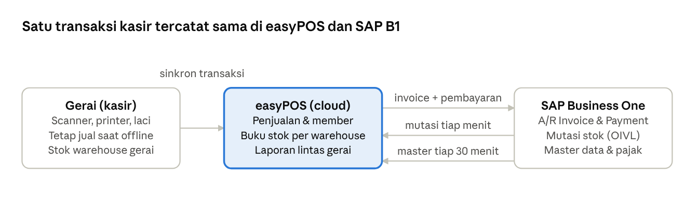

# easyPOS — Pitch Produk

4 November 2026 · Januar F

**easyPOS adalah POS berbasis cloud untuk retailer multi-gerai yang langsung terhubung dengan SAP Business One: penjualan di kasir otomatis menjadi A/R Invoice dan pembayaran di SAP, dan stok di easyPOS identik dengan stok SAP setiap menit.** Produk sudah selesai dikembangkan, lolos 215 tes otomatis, dan sudah diuji langsung ke server SAP B1.

## Masalah

Retailer yang tumbuh dari satu ke banyak gerai kehilangan kontrol: penjualan dan stok dicatat terpisah per gerai, harga tidak seragam, dan laporan diolah manual. Yang sudah memakai SAP Business One menanggung beban tambahan: transaksi kasir diinput ulang ke SAP, sehingga stok di toko dan di SAP tidak pernah sama.

- **Owner** buta terhadap performa lintas gerai dan tidak bisa memutuskan restock atau harga berbasis data.
- **Tim back-office** menginput ulang penjualan ke SAP setiap hari, rawan salah dan terlambat.
- **Kasir** bekerja lambat, takut salah hitung, dan transaksi bisa hilang saat internet putus atau pindah perangkat.
- **Pelanggan** menerima harga yang tidak konsisten dan program loyalitas tidak berjalan.

Makin banyak gerai, makin mahal merapikan data yang sudah tersebar.

## Solusi

easyPOS menjadi satu sistem kasir untuk semua gerai, dengan SAP Business One tetap sebagai pusat data perusahaan.

Kasir menjual dari stok warehouse gerai; penjualan langsung terposting ke SAP, sementara mutasi stok dan master data dari SAP kembali ke easyPOS secara otomatis.

## Untuk siapa

Retailer di Indonesia dengan 1 gerai yang berencana tumbuh ke 2–10 gerai (minimarket, kelontong, F&B kecil, fashion), terutama yang back-office-nya sudah memakai SAP Business One.

| Peran | Yang dikerjakan di easyPOS | Yang didapat |
| --- | --- | --- |
| Owner | Mengatur kebijakan perusahaan, pajak, integrasi SAP, dan melihat laporan lintas gerai | Kontrol penjualan, stok, dan harga dari mana saja |
| Store Manager | Mengelola produk, harga, stok, pelanggan, review transaksi, dan tutup toko gerainya | Alat kontrol gerai tanpa akses setting perusahaan |
| Kasir | Checkout, retur, penjualan dengan pengiriman, daftar member | Checkout di bawah 30 detik, tetap jalan saat internet putus |

## Yang sudah jadi

Seluruh scope MVP sudah dikembangkan, ditambah integrasi SAP B1 yang semula direncanakan untuk fase "Nanti".

| Area | Fitur |
| --- | --- |
| Kasir (POS) | Penjualan multi metode bayar, struk thermal via WebUSB dengan cadangan cetak HTML, cash drawer, retur, penjualan dengan pengiriman |
| Offline & lintas perangkat | Semua metode bayar tetap diproses saat internet putus lalu disinkronkan tanpa duplikat; transaksi bisa ditahan dan dilanjutkan di perangkat lain |
| Produk & harga | Produk global per perusahaan dengan SKU tetap, kategori, merk, satuan, daftar harga ber-tanggal efektif dipilih per gerai, promosi |
| Stok | Saldo per warehouse gerai dengan riwayat mutasi lengkap, penyesuaian stok, transfer antar gerai dengan jejak |
| Pelanggan & loyalitas | Member Silver/Gold/Platinum dengan poin, grup pelanggan, default pelanggan retail per gerai |
| Kontrol | Peran Owner/Store Manager/Kasir, minimal satu Owner aktif, review transaksi dan tutup toko dengan hitung kas per pecahan, activity log |
| Laporan | Per gerai, per SKU, terlaris, rata-rata belanja; ekspor Excel dan PDF ber-kop |
| Pajak | PPN inklusif/eksklusif dengan Tax Group yang sama dengan SAP |
| Integrasi SAP B1 | Impor master data, mutasi stok tiap menit, posting penjualan, pengiriman pelanggan baru (detail di bagian berikut) |

## Keunggulan integrasi SAP B1

SAP tetap menjadi sumber kebenaran, dan easyPOS bekerja sebagai perpanjangan tangannya di gerai, tanpa input ulang dan tanpa add-on di sisi SAP.

- **Stok identik dengan SAP.** Setiap mutasi stok di SAP (penerimaan, transfer, goods issue/receipt, penjualan) disalin baris per baris setiap menit, lengkap dengan nomor dokumen SAP. Saldo SAP ikut dicek ulang sehingga selisih langsung terlihat.
- **Penjualan langsung terposting.** Setiap transaksi kasir menjadi A/R Invoice dan Incoming Payment tunai yang otomatis terekonsiliasi, dengan kode pajak dan warehouse gerai yang benar.
- **Tidak ada dokumen ganda.** Setiap dokumen ditandai UDF berisi ID transaksi easyPOS, sehingga pengiriman ulang setelah gagal atau timeout tidak membuat invoice kedua.
- **Pelanggan baru tersinkron.** Pelanggan yang didaftarkan kasir dikirim ke SAP sebagai Business Partner, dan CardCode dari series retail SAP menjadi kode pelanggan di easyPOS.
- **Master data satu arah.** Produk, harga, warehouse, pajak, dan grup pelanggan diimpor dari SAP dan hanya-baca di easyPOS. Sinkronisasi 30 menit hanya mengambil data yang berubah.
- **Aman untuk produksi.** Koneksi SAP terkunci setelah impor awal; perubahan butuh konfirmasi password Owner dan tes login SAP. Cost item tidak pernah ditampilkan di easyPOS.

## Bukti kesiapan

Alur inti sudah diuji langsung ke server SAP Business One 10.0 FP 2502 (Service Layer) pada 4 November 2026, dan 215 tes otomatis lulus.

| Uji | Hasil |
| --- | --- |
| Penjualan kasir ke SAP | SAL/202611/0001 (Rp 28.860) dan SAL/202611/0002 (Rp 32.400) terposting sebagai A/R Invoice dan Incoming Payment; invoice langsung berstatus lunas |
| Pajak | Total PPN easyPOS sama persis dengan SAP, baik harga eksklusif maupun inklusif PPN |
| Stok setelah penjualan | Stok berkurang saat transaksi dan tidak tercatat dua kali saat mutasi invoice ditarik dari SAP |
| Mutasi dari SAP | Goods Receipt PO, Goods Issue/Receipt, dan Inventory Transfer masuk dalam 1–2 menit |
| Rekonsiliasi | Selisih saldo easyPOS vs SAP: 0 di semua item dan warehouse |
| Hemat bandwidth | Saat tidak ada perubahan, sinkronisasi produk turun dari 7 menjadi 1 baris dan saldo stok tidak dibaca sama sekali |

## Berikutnya

Langkah pertama setelah MVP adalah menuntaskan posting ke SAP untuk transaksi selain penjualan tunai; jadwalnya belum ditetapkan.

| Tahap | Cakupan |
| --- | --- |
| Lanjutan integrasi SAP | Retur sebagai A/R Credit Memo, transfer dan penyesuaian stok ke SAP, pembayaran non-tunai di Incoming Payment |
| V2 | QRIS dinamis via XendIt, harga khusus pelanggan, redeem poin, voucher, modul pembelian dan supplier, multi-currency, laporan terjadwal |
| V2 — SaaS | Multi-tenant dengan billing dan subscription |

## Langkah berikutnya

Kami mengajak retailer pengguna SAP Business One menjalankan pilot satu gerai selama 30 hari, dengan target ≥ 300 transaksi dan kasir mandiri setelah training ≤ 1 jam.

1. Demo alur kasir sampai dokumen terbentuk di SAP, memakai database SAP calon pelanggan.
2. Persiapan SAP: UDF penanda easyPOS, akun kas per warehouse, dan numbering series pelanggan retail.
3. Impor data awal dari SAP, lalu go-live di gerai pilot.
4. Evaluasi terhadap target pilot, lalu perluasan ke gerai berikutnya tanpa migrasi data.

**Pertanyaan terbuka untuk pitch:**

- [ ] Model harga: per gerai per bulan, per kasir, atau paket implementasi?
- [ ] Siapa calon pelanggan pilot pertama?
- [ ] Query mutasi stok di server SAP sempat tertahan beberapa menit setelah dokumen baru; perlu dicek admin SAP sebelum go-live.
